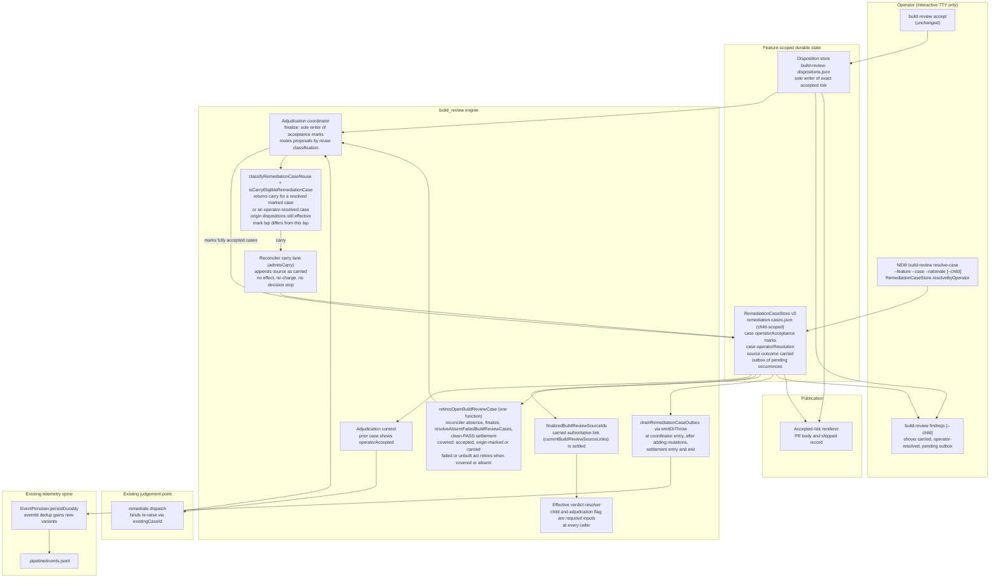

# Components: operator acceptance survives a build_review re-raise (respec of #3271)

**Last updated:** 2026-10-21
**Scope:** Proposed change for jstoup111/ai-conductor#3271, including the outcomes consolidated from
#3303.

Operator acceptance becomes durable case state, written at the moment it happens:

- **Coordinator `finalize`** writes acceptance marks on cases, at the point where it already retires
  operator-accepted cases. It is the only writer of those marks.
- **Reconciler carry lane** is the only component that decides carry. A later `existingCaseId`
  binding to a marked case is appended there as a `carried` source.
- **Settled-source function** (`finalizedBuildReviewSourceIds`) is the only reader path for carry.
- **Case-store outbox** holds each occurrence this feature adds. It is written in the same
  transaction as the state change and drained through the event persister's eventId dedup.

The disposition store remains the only writer of exact accepted risk.

## Diagram

## Legend

- **NEW**: a component or command that does not exist on main.
- `CASES` is the only new persisted state. v2 stays readable and is upgraded to v3 on write,
  following the existing v1→v2 precedent.
- The carry decision lives in exactly one place, `CLASSIFY` → `RECON`. `SETTLED` and every reader
  consume the persisted `carried` outcome and never re-derive it.
- Event emission happens only in `DRAIN`. Nothing this feature adds emits directly after a write.

## Change Log

| Date | Change | Reason |
|------|--------|--------|
| 2026-10-20 | Initial generation | Respec of #3271 after revert #3319 |
| 2026-10-20 | Carry requires a resolved case; retirement predicate shared with reconciler absence | Architecture review refinement (ADR D3, D5) |
| 2026-10-21 | Plan-update: owner function names, #3292 authoritative-link baseline, drain points, findings --child | /plan for the #3271 respec |
