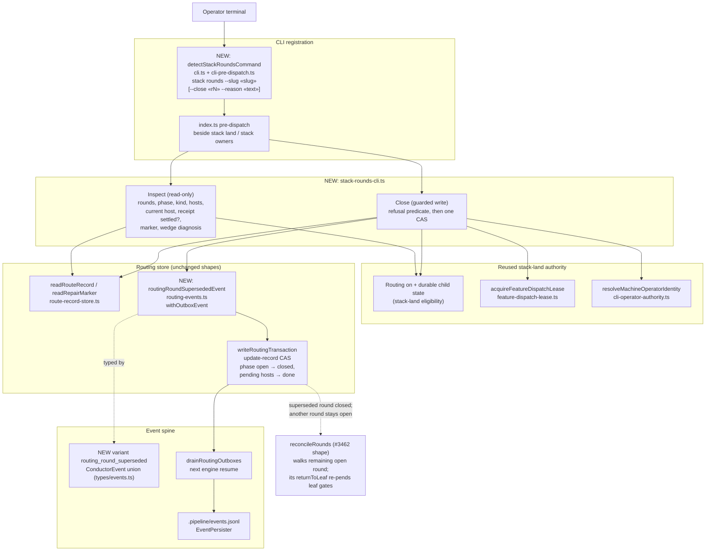

# Components: Operator Inspection and Supersession of Routed Rounds (#3459)

**Last updated:** 2026-10-29
**Scope:** The new operator CLI family `ai-conductor stack rounds`. A read-only inspect form lists
every routed round, the repair marker and each receipt's settlement state. A guarded `--close` form
supersedes one stale open round through the existing routing compare-and-swap. Shown: the CLI
registration (`cli.ts`, `cli-pre-dispatch.ts`, `index.ts`), the new `stack-rounds-cli.ts`
dispatcher, the reused stack-land authority primitives, the routing store, and the event spine path
that carries the supersession occurrence.

## Diagram

## Legend

- **NEW** marks a component or variant this feature adds. Every other node already exists and keeps its
  shape. In particular, the `RouteRecord` schema, the repair-marker blob and the kickback ledger are unchanged.
- **Close refusal predicate:** routing disabled, or not a stacked feature; feature in flight (lease held);
  no approved operator identity; empty `--reason`; round absent, unreadable or not `open`; any host in
  `admitted`, `repairing`, `built`, `reroute-moved`, `abandoning` or `abandoned`; repair marker names this
  round; record carries an in-progress reroute; no *other* non-closed round exists, because closing the sole
  round would skip `returnToLeaf`.
- **Budget:** settled receipt charges stay in the ledger. An unsettled receipt was never charged
  (`settleRoundAtDispatch`), so supersession drops no charged budget.
- Solid arrows are calls. Dotted arrows are typing or downstream effect.

## Change Log

| Date | Change | Reason |
|------|--------|--------|
| 2026-10-29 | Initial generation | #3459 outcome 3: supported operator recovery for wedged routed rounds |
