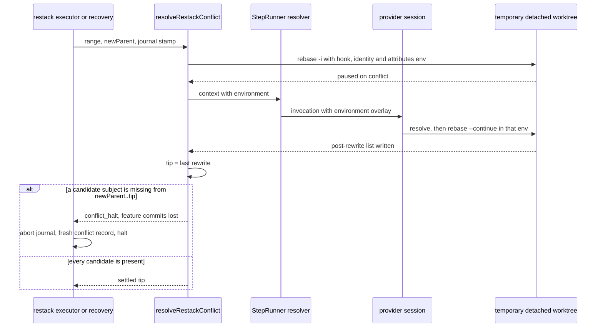
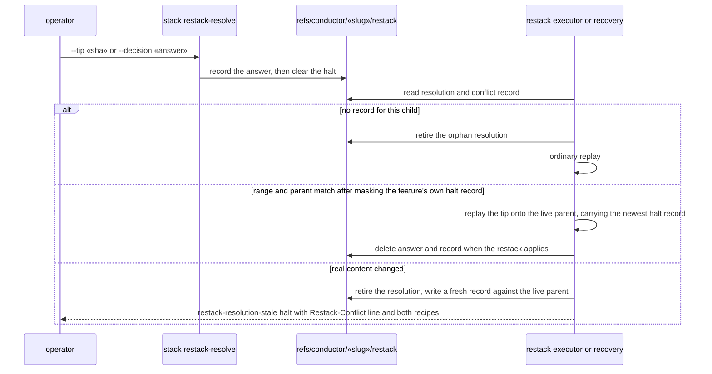
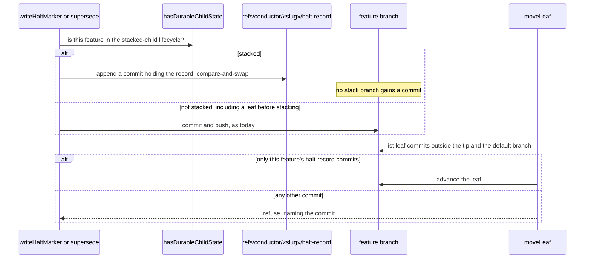

# Sequences: Stacked restack recovery and stacked halt records

**Last updated:** 2026-11-02
**Scope:** Resolver tip authority, recorded-resolution consumption, stale resolutions, and where a stacked feature's halt record lives. Source: #3582, folding #3557 and #3576.

## Diagram: a provider-settled restack keeps every candidate commit

## Diagram: consuming or retiring a recorded resolution

## Diagram: where a halt record goes

## Legend

`«slug»` is the feature slug. "Masking" means comparing trees with only `.docs/halted/«slug».md` removed.

## Change Log

| Date | Change | Reason |
|------|--------|--------|
| 2026-11-02 | Initial generation | #3582 DECIDE |
