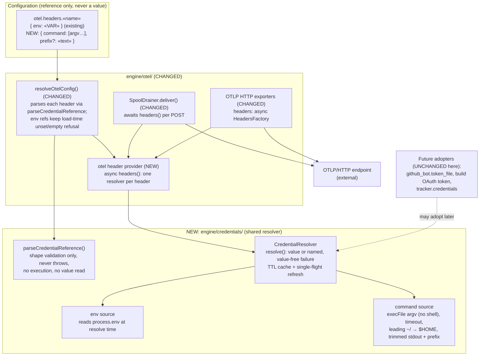
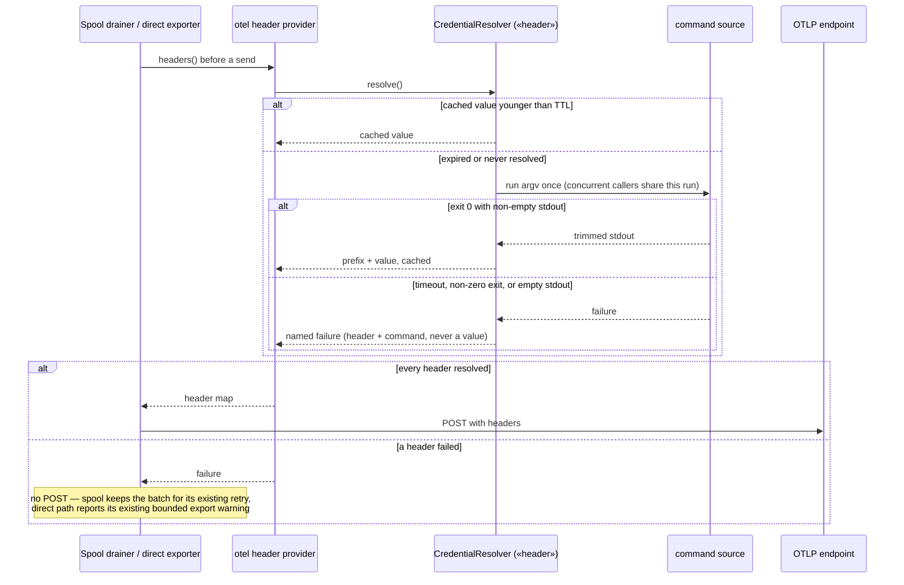

# Components: Shared credential-reference resolver, first consumer `otel.headers`

**Last updated:** 2026-10-28
**Scope:** A new engine module that turns a credential *reference* in configuration into a credential
*value* on demand, from a pluggable source (`env` or `command` in this slice), behind a TTL cache with
single-flight refresh. `otel.headers` is its only consumer in this change: the config resolver parses
references through it, and both OTLP/HTTP delivery paths (the spool drainer's per-POST headers and the
direct exporters' async headers factory) ask it for values at send time. Other credential consumers
(`github_bot.token_file`, the daemon build OAuth token, `tracker.credentials`) are shown as future
adopters only and are not changed.

## Diagram

## Legend

- **NEW** — added by this change. **CHANGED** — an existing component whose behavior changes.
- **UNCHANGED here** — named only to bound the resolver's interface; not edited in this change.
- Dashed arrow — possible future dependency, not built in this change.
- «name» — a variable part of a label.
- Credential values exist only inside the resolver cache and the outgoing request headers; they are
  never written to configuration, errors, events, or the spool.

## Change Log

| Date | Change | Reason |
|------|--------|--------|
| 2026-10-28 | Initial generation | Command-sourced OTLP header credentials via a shared resolver (approach B) |
