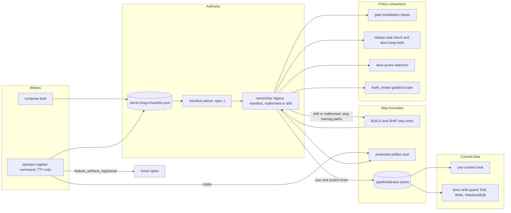

# Components: path policy reads feature ownership from the artifact manifest (#3418, spec 2 of 3)

**Last updated:** 2026-10-28
**Scope:** Proposed structure for spec 2. The engine computes one ownership result for a feature
from its committed manifest (`.docs/«slug»/manifest.json`). It does this at every BUILD/SHIP step
entry, at rebase, at restack, and when prune selects files. Every path policy that today decides
ownership by folder and basename reads that result instead. Features without a manifest keep
today's folder and stem rules unchanged. No artifact file moves in this spec.

## Diagram

## Legend

- **Ownership**: one engine function that takes a feature slug and a file source (the worktree, a
  git ref, or the prefetched default-branch tree). It returns one of four outcomes:
  - **legacy**: no manifest exists. Every consumer runs today's folder and stem rule unchanged.
  - **manifest**: the paths the manifest lists, plus the manifest file itself.
  - **malformed**: the spec 1 parser failure, named.
  - **drift**: a listed file is missing, or the feature added an in-scope file the manifest does
    not list. Every disagreeing path is named.
- **Step boundary**: BUILD and SHIP step entry already verifies the seal on every attempt. The
  ownership check runs there first. A malformed or drift outcome refuses the step with its reason,
  as a seal failure does today. A run never proceeds on a partial set.
- **Seal**: for a manifest-backed feature, the sealed set is today's five folders, plus every
  listed path, plus the manifest. A changed listed path is a self-amendment, judged by build_review
  as today. A changed manifest is a seal violation, whatever tool made the edit.
- **Phase marker**: the engine writes `own:` and `protect:` lines from the ownership result. The
  pre-commit hook reads them instead of re-deriving a stem in bash, and refuses a staged manifest.
  Without a manifest the engine writes neither line, and the hook keeps its stem rule. For
  `remediate`, the write allowlist narrows from `.docs/plans/` to the listed plan path.
- **Register command**: the only way to add an artifact after land. It runs only from an operator
  TTY. It re-renders the manifest through the spec 1 renderer, commits it, rotates the seal for the
  manifest, and emits `feature_artifacts_registered` on the existing spine.
- **Rebase**: the seal check before HEAD moves uses ownership. No automatic tier resolves a
  manifest conflict: docs keep-both declines it, the model-driven resolver is never dispatched for
  it, and the rebase stops as needs-human naming the manifest.
- **Reseal**: accepts a listed protected-kind path wherever it lives, and always refuses the
  manifest, naming the register command.
- **Allow entries**: an `allow:` entry naming a file matches exactly in both the docs write guard
  and the pre-commit hook; an entry ending in `/` keeps prefix matching.
- **Prune**: for a shipped feature with a manifest, the selection is its listed prunable-kind
  entries plus the manifest. Halted and plan-review records keep today's stem rule, because the
  manifest does not list them.
- **build_review**: the manifest is excluded from the graded diff as machinery-authored, like
  shipped records. The testQuality preflight never treats listed artifacts or the manifest as
  production.

## Change Log

| Date | Change | Reason |
|------|--------|--------|
| 2026-10-28 | Initial generation | #3418 spec 2: path policy decides ownership from the manifest |
