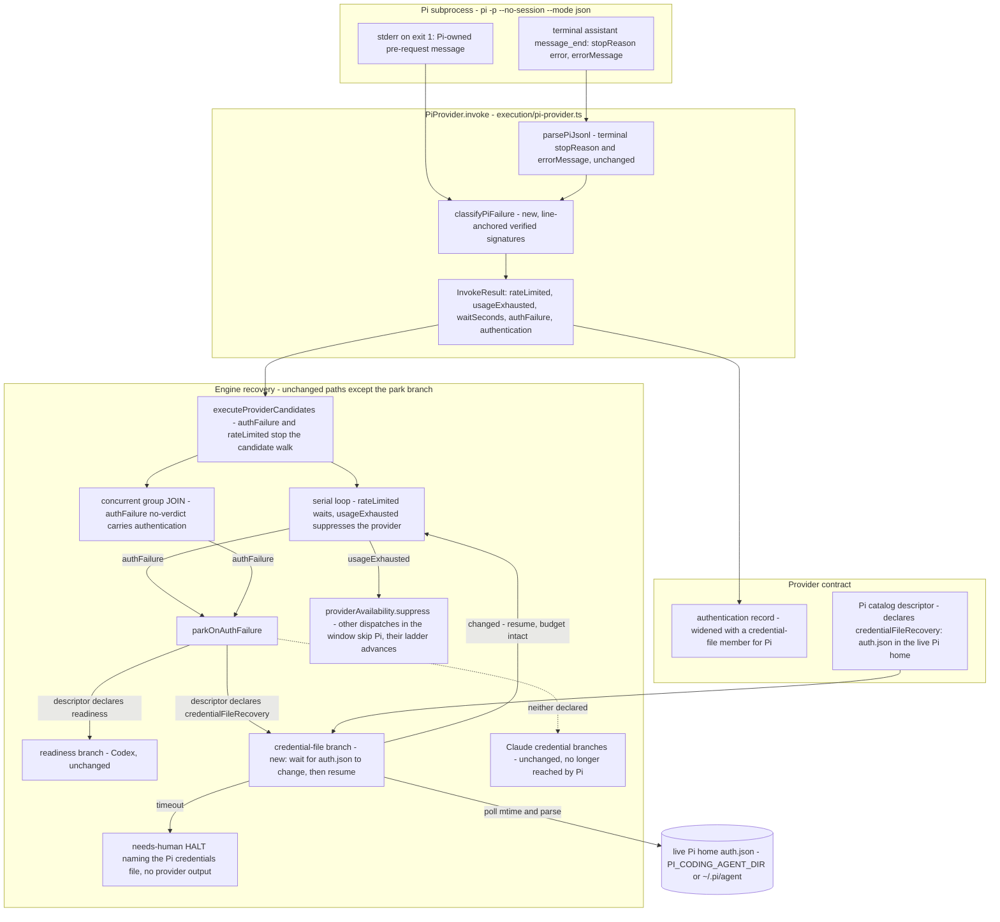

# Components: Pi auth, rate-limit, and usage-exhaustion recovery (#2718)

**Last updated:** 2026-10-28
**Scope:** Proposed classification of Pi authentication failures, rate limits, and usage
exhaustion in the Pi adapter, and the Pi-owned credential park that an auth failure enters.
Claude and Codex classification and parking are unchanged.

Pi reports a failed provider request in one of two channels, verified against Pi 1.0.0:

- **Error stop, exit 0.** The terminal assistant `message_end` carries `stopReason: "error"` and an
  `errorMessage`. An HTTP rejection renders as `<status>: <body>` for OpenAI-compatible APIs and
  `<status> <body>` for the Anthropic API. Pi retries a 429 three times before this stop.
- **Thrown, exit 1.** A failure before the request, such as no configured credential, prints Pi's
  own message on stderr and emits no assistant message.

Today `parkOnAuthFailure` (`engine/conductor.ts`) has two recovery shapes. A provider that declares
`readiness` (Codex) polls a readiness probe. Every other result falls through to the Claude
branches, which poll `~/.claude/.credentials.json` or a daemon build token. A Pi `authFailure`
would therefore wait on Claude's credentials. The new branch sits before that fall-through and is
selected by a catalog declaration, never by a provider-id comparison.

## Diagram

## Notes

- The signatures and their captures are recorded in
  `adr-2026-10-28-pi-auth-and-rate-limit-signatures-are-anchored-to-captured-output`.
- Usage exhaustion reuses the existing serial-loop path. `usageExhausted` with an
  `actualProvider` suppresses that provider in `providerAvailability`. Every other candidate walk
  in that window refuses Pi with `provider-suppressed` and moves on, while the dispatch that saw the
  exhaustion waits for the deadline, as it does for Codex.
- The self-host throwaway Pi home is provisioned per candidate dispatch from the live home (D25 of
  `adr-2026-09-24-built-in-provider-catalog-and-boot-discovery`). After the park resumes, the next
  dispatch therefore picks up the refreshed credential.
