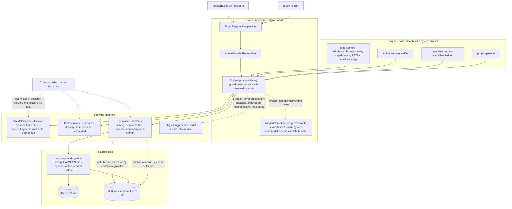
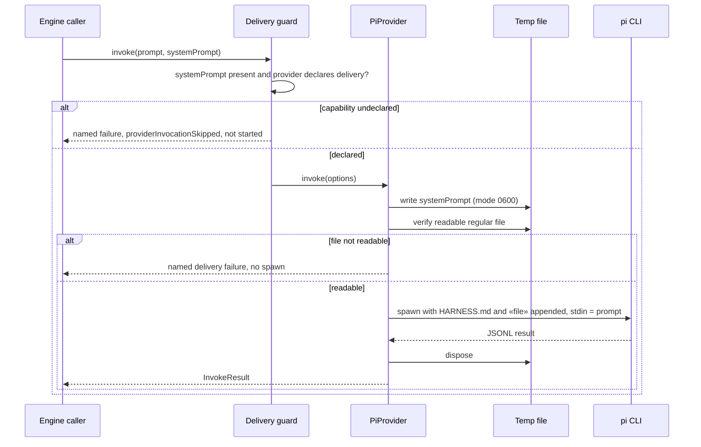

# Components: System-prompt delivery across providers (#3309)

**Last updated:** 2026-10-24
**Scope:** Proposed delivery of `InvokeOptions.systemPrompt` to the Pi adapter, a declared
per-provider system-prompt delivery capability, and the guard that refuses a provider which does
not declare it. Claude and Codex delivery mechanisms are unchanged.

Every production `LLMProvider` instance, built-in or plugin, is obtained through one lookup:
`registry.get<LLMProvider>('llm_provider', key)` in `createProviderRuntimeSet`
(`provider-runtime.ts:109`). The roughly ten engine call sites that call `provider.invoke`
directly receive that resolved instance. The guard therefore wraps the provider at resolution, so
every invoke path inherits it without editing each call site.

The capability follows the existing per-instance declaration pattern (`lifecycleCapability`,
`nativeSchemaCapability` on `LLMProvider`), which a plugin module can also declare. Plugin
manifest `capabilities` are not retained by `PluginRegistry`, so the declaration lives on the
provider object, not in `plugin.yml`.

## Diagram

## Sequence: Pi dispatch carrying a system prompt

## Legend

- **New** nodes: the delivery guard, Pi temp-file delivery, and the contract test.
- Dashed arrow from the guard: the refusal path for an undeclared provider.
- `«file»`: the per-invocation temp file path. It is passed as its own argv value, so prompt size
  never reaches the 128 KiB per-argument `E2BIG` limit.
- Pi joins repeated `--append-system-prompt` values with a blank line, in order, so HARNESS.md
  stays first and the engine prompt follows it. Stdin carries only the prompt, which keeps a
  leading `/skill` command recognized.

## Change Log

| Date | Change | Reason |
|------|--------|--------|
| 2026-10-24 | Initial generation | #3309: Pi drops `InvokeOptions.systemPrompt` silently |
| 2026-10-24 | Added refusal telemetry classification node | Plan update: Task 7 classifies the refusal in candidate telemetry |
