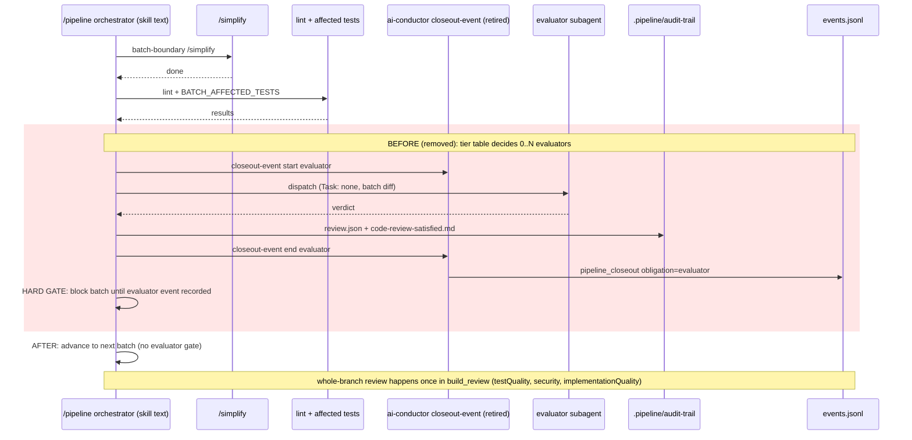
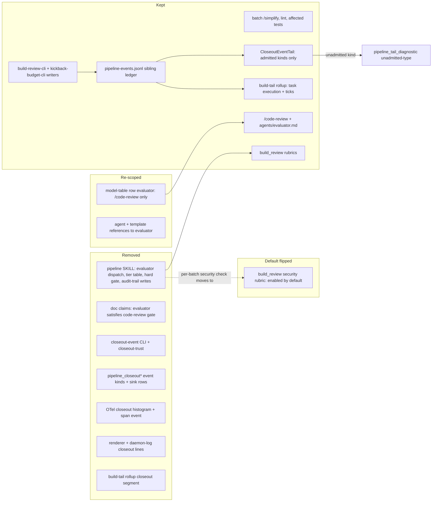

# Sequence: /pipeline batch boundary after batch-evaluator retirement

**Last updated:** 2026-10-12
**Scope:** What changes at a `/pipeline` batch boundary and in the closeout-obligation vocabulary when the
batch evaluator is retired (#3056). `build_review` becomes the single post-build review authority; its
default-on `implementationQuality` rubric shipped in #3086. The diagram adds no new step, event kind,
store, or gate. It removes the evaluator dispatch and the doc claims built on it, and it flips the `security` rubric's
default to enabled so that a default build still gets a security review. It also retires the whole closeout-obligation
telemetry channel, which had no producer except the evaluator. The sibling ledger survives for build-review and
kickback-budget events, and its tail now re-emits only admitted kinds
(adr-2026-10-12-retire-pipeline-closeout-obligation-telemetry).
`agents/evaluator.md` stays, because standalone `/code-review` still dispatches it.

## Diagram: one batch boundary, before and after

## Diagram: surfaces touched

## Legend

- Red block (sequence): behavior that exists today and is deleted by this feature, including the only producer of
  closeout events.
- `CLI (retired)`: `bin/ai-conductor` resolves `src/conductor/dist` on every invocation. A session that started under
  the old skill text and calls `closeout-event` after a rebuild gets the CLI's unknown-command exit 1. The operator
  accepted that window.
- `TAIL`: the sibling-ledger tail re-emits only `ExternalPipelineEvent` kinds. Leftover closeout lines become one
  `unadmitted-type` diagnostic each.

## Change Log

| Date | Change | Reason |
|------|--------|--------|
| 2026-10-12 | Initial generation | DECIDE for #3056 (retire /pipeline batch evaluators) |
