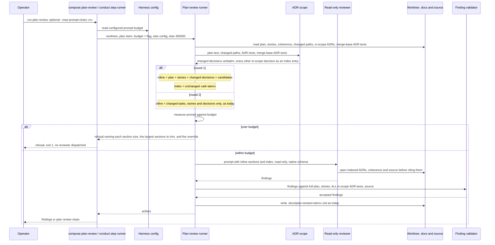

# Sequence: plan review prompt carries an index, not every cited ADR

**Last updated:** 2026-10-24
**Scope:** Proposed flow for #3278. The round-1 plan-review prompt keeps the plan, the stories and
the in-scope ADR decisions whose text differs from the spec's merge base (plus every decision of an
ADR the spec adds) verbatim. Every other in-scope decision, and the coherence artifact, becomes an
index entry (id, title, worktree path) that the read-only reviewer opens with its own read tools. The prompt budget defaults to 400,000 characters,
and the operator can raise it with `plan_review.max_prompt_chars` or once with a CLI flag. An over-budget prompt is refused
before dispatch, naming each section's size, what to change, and the override. Validation still
grounds findings against the full artifacts. Round 2 keeps today's changed-only selection. There is
no new process, store, persisted schema, event or land rung. The flow extends the plan-review
runner, the ADR scope helper, the config surface, the `compose plan-review` CLI and the reviewer
brief.

## Diagram

## Legend

- **Changed decision** is an in-scope decision whose passage text differs from the same
  decision at the spec's merge base (`resolveIdeaFiles` already resolves it), or any decision of
  an ADR the spec adds. An amendment note sits inside its decision's passage, so an amended
  decision is a changed one. Changed decisions stay inline because they are what the spec amends.
- **Indexed decision** is every other in-scope decision, whether its ADR is cited or changed
  elsewhere. It becomes an index entry with its title and worktree path, with no passage text.
- **Coherence** becomes one index entry with its worktree path.
- **Validator** is unchanged: it grounds quoted passages against the full artifact texts, so a
  finding quoting an indexed ADR still validates.
- **Budget** precedence is the CLI flag, then the config key, then the 400,000-character default.
  The refusal happens before any provider is dispatched, so it spends no tokens.
- **Round 2** keeps the existing digest-based changed-only selection; only the budget and refusal
  wording change for it.

## Change Log

| Date | Change | Reason |
|------|--------|--------|
| 2026-10-24 | Initial generation | #3278: plan review refuses Large specs over 400k characters |
| 2026-10-24 | Inline rule narrowed to changed decisions; config block named | Architecture review: on #2945 every cited ADR was changed, so whole-ADR inlining saved nothing |
