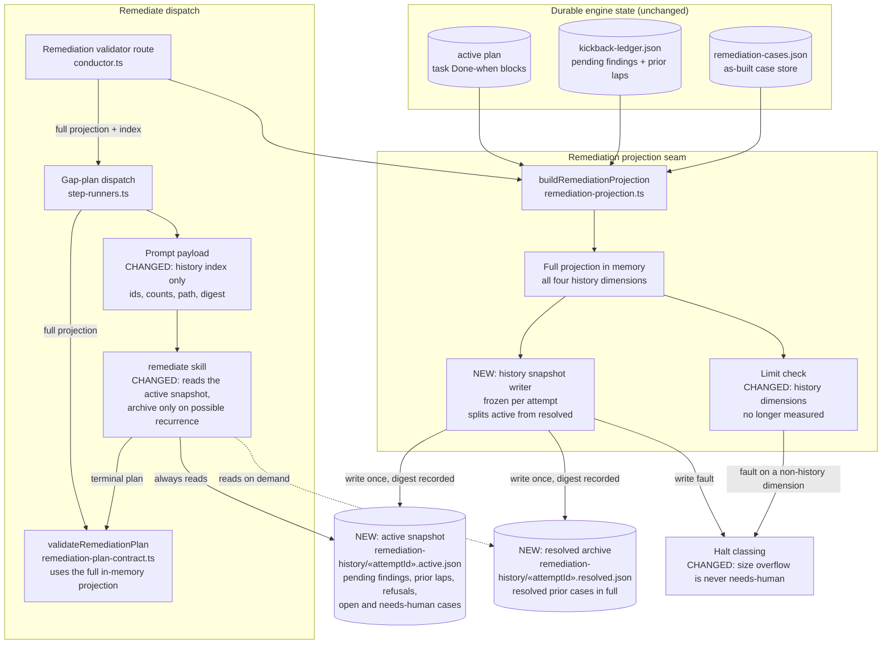
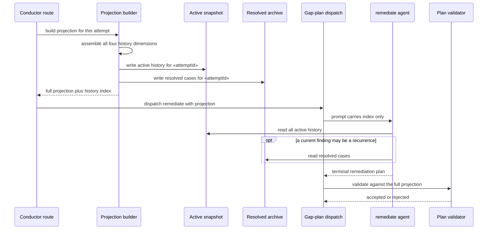

# Components: Remediation History Handed Off By File (#3677)

**Last updated:** 2026-11-15
**Scope:** The remediation input seam — `buildRemediationProjection`
(remediation-projection.ts), its one caller in the conductor's remediation validator
route (conductor.ts), the `remediate` gap-plan dispatch (step-runners.ts), the
terminal-plan validator (remediation-plan-contract.ts), and the `remediate` skill.

## Diagram

## Sequence: one remediation lap

## Legend

- **Full projection in memory** — the engine still assembles every history dimension, exactly
  as today. Only the delivery to the agent changes; the terminal-plan validator keeps reading
  the in-memory projection, so the agent's file read is never trusted as validation input.
- **Active snapshot** — one frozen file per remediation attempt holding pending findings, prior
  laps, refusals, and every open or needs-human prior case, in full. A resolved case whose
  source carries a current pending finding id is also placed here. The agent always reads it.
- **Resolved archive** — a second frozen file per attempt holding the remaining resolved prior
  cases in full. The agent opens it only when a current finding may be a recurrence of a
  resolved case. The engine does the split; when to open the archive is the agent's judgement.
- The prompt carries each file's path and digest so the agent reads exactly the history the
  engine validated against.
- **History index** — what the prompt keeps in place of the inlined history: per-dimension ids
  and counts, both file paths, and their digests. Archived resolved cases are listed by case
  id and source finding ids only.
- **Limit check** — required references, tasks, evidence, and the total structured bound are
  still measured. The four history dimensions are no longer measured against a byte cap.
- **Halt classing** — a size overflow can no longer be a needs-human halt. The needs-human
  class stays only for the faults an operator can act on: a prior repair task missing from the
  active plan, and an unreadable case store.
- **NEW / CHANGED** annotations mark the behavior this feature changes; everything else is the
  existing seam.
- `«…»` — placeholder for a variable value.
- Out of scope: the `build_review` case-context payload (#3565) and the PRD-widening
  reconciliation dispatch, which do not pass through this history delivery.

## Change Log

| Date | Change | Reason |
|------|--------|--------|
| 2026-11-15 | Initial generation | Composer DECIDE for #3677 |
| 2026-11-15 | Split history into an active snapshot and a resolved archive | Operator direction during architecture review |
