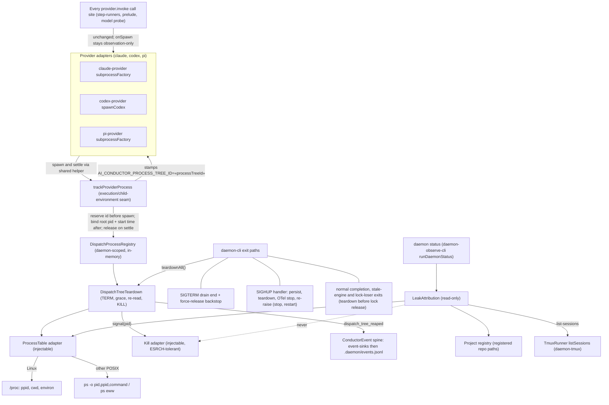
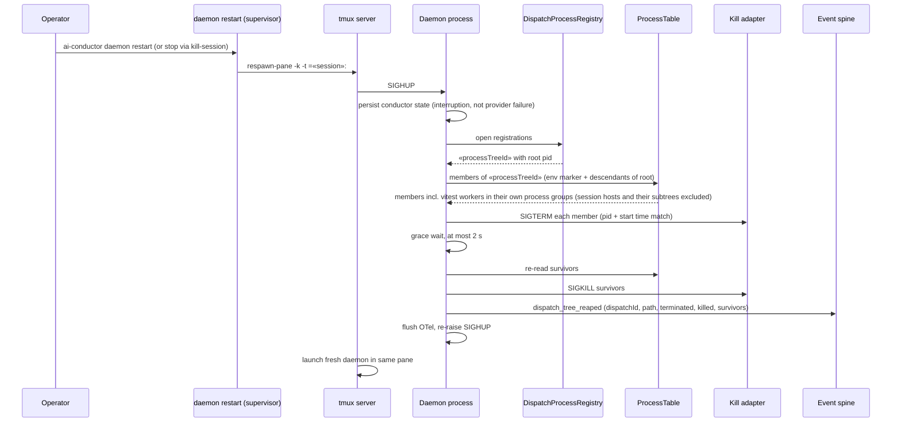
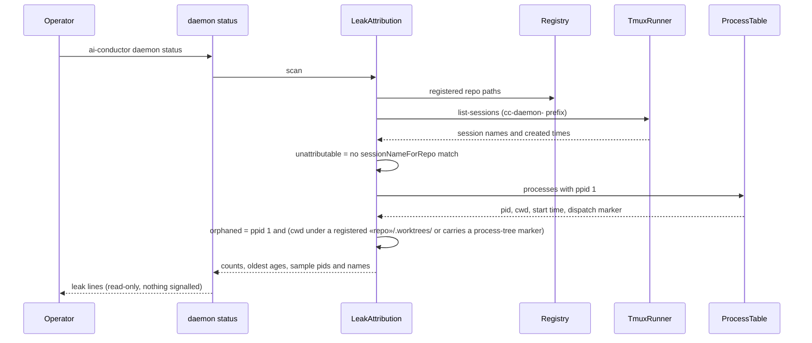

# Components and sequences: Dispatch process-tree teardown and leak status surface

**Last updated:** 2026-10-12
**Scope:** To-be design for jstoup111/ai-conductor#544 (feature
`reap-unattributable-leaked-cc-daemon-tmux-sessions`, Tier M, technical track). Covers how the
daemon attributes every process a provider dispatch spawns, terminates that set on each exit path
the daemon controls, and reports (never reaps) unattributable `cc-daemon-*` tmux sessions and
orphaned worktree processes in `daemon status`. Test-side tmux isolation (#2476) and the
test kill-switch session guard (#257) are out of scope and shown nowhere.

## Component diagram

## Sequence: `daemon restart` while a build is running

## Sequence: `daemon status` leak report

## Legend

- **DispatchProcessRegistry**: an in-memory map inside the daemon process from each open dispatch
  id to its provider root pid. It is never persisted, so it is not a second telemetry channel; the
  durable record is the `dispatch_tree_reaped` event.
- **trackProviderProcess**: one helper in `src/execution/child-environment.ts` that all three
  adapters call at spawn. It stamps the marker into the child environment, registers the root, and
  triggers teardown when that subprocess settles. Hooking the adapters (not each `invoke` call
  site) covers every provider path, including those outside the lifecycle supervisor.
- **Dispatch membership**: a process belongs to a dispatch when it carries the inherited
  `AI_CONDUCTOR_PROCESS_TREE_ID` marker or is a descendant of the recorded root. The marker survives
  reparenting to init, which a parent-pid walk alone does not; the walk covers children that scrub
  their environment. A process found only by marker that is a session host (a session
  leader with a session-leader child, e.g. a tmux server), and everything below it, is never
  signalled; status reports a host whose parent is init. A detached leader that hosts no session is
  an ordinary member.
- **ProcessTable / Kill adapter**: the only process boundary. Both are injectable so tests never
  signal real pids (repo Test Process Isolation rule).
- **LeakAttribution**: read-only. It has no edge to the Kill adapter by construction.
- `«x»` marks a variable value.

## Change Log

| Date | Change | Reason |
|------|--------|--------|
| 2026-10-12 | Initial generation | DECIDE for #544, Approach B (dispatch-tree teardown + read-only status surface) |
