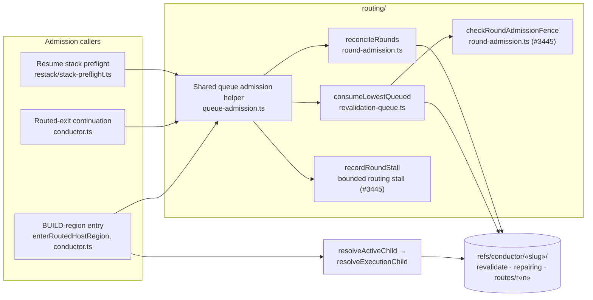
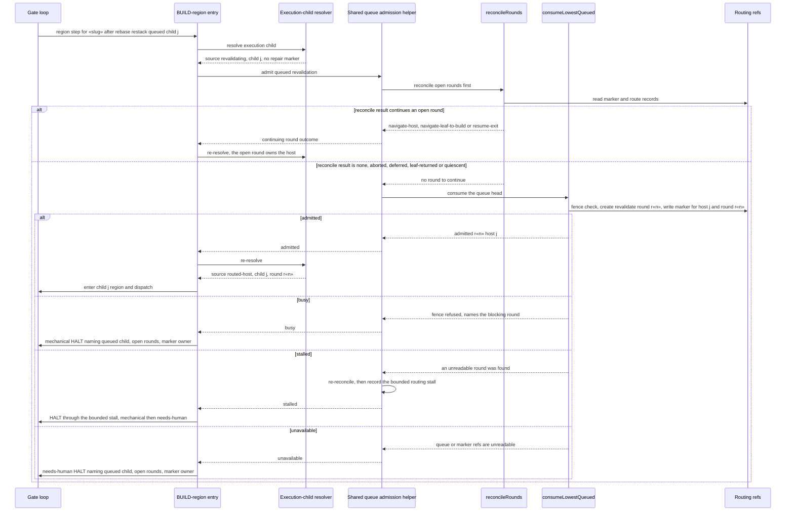

# Architecture: Shared revalidation-queue admission for stacked child BUILD entry

**Last updated:** 2026-10-31
**Scope:** How a queued closed-child revalidation becomes an open `revalidate` round and a repair
marker before child BUILD-region entry. Covers the in-loop `rebase` restack path (#3477) and the
routed-exit fall-through path (#3473). Spec stem: `rebase-base-refresh-revalidation-halts-needs-human`.

## Components

## Sequence: in-loop BUILD-region entry with a queued revalidation

## Legend

- **Shared queue admission helper.** This is the single reconcile→consume sequence. Today it is
  duplicated in resume preflight and the routed-exit continuation and missing at BUILD-region
  entry. Each caller keeps its own mapping from outcome to action. Preflight returns
  `navigate-host`, the routed exit returns the next region index, and region entry re-resolves
  and enters.
- **Region entry admits before refusing.** A `revalidating` execution child with no repair marker
  is no longer a terminal refusal. It is the signal to run admission. Region entry halts only when
  admission reports genuine unavailability or a fence or stall stop.
- **Nothing queued means unchanged behavior.** When a restack queues nothing, the cursor never
  resolves `revalidating`, the helper is not reached at region entry, and the loop proceeds to the
  whole-feature gates as today.
- **One admission per queue head.** The helper relies on `consumeLowestQueued`, which returns `busy`
  when a marker already exists or the #3445 fence refuses. A resume that follows an in-loop
  admission therefore continues the open round and never creates a duplicate `revalidate` round.
- Guillemets (`«slug»`, `r«n»`) mark variable parts of names.

## Change Log

| Date | Change | Reason |
|---|---|---|
| 2026-10-31 | Initial component and region-entry admission sequence. | Spec for #3477 with #3473 folded in: queued revalidations halt at child BUILD entry. |
