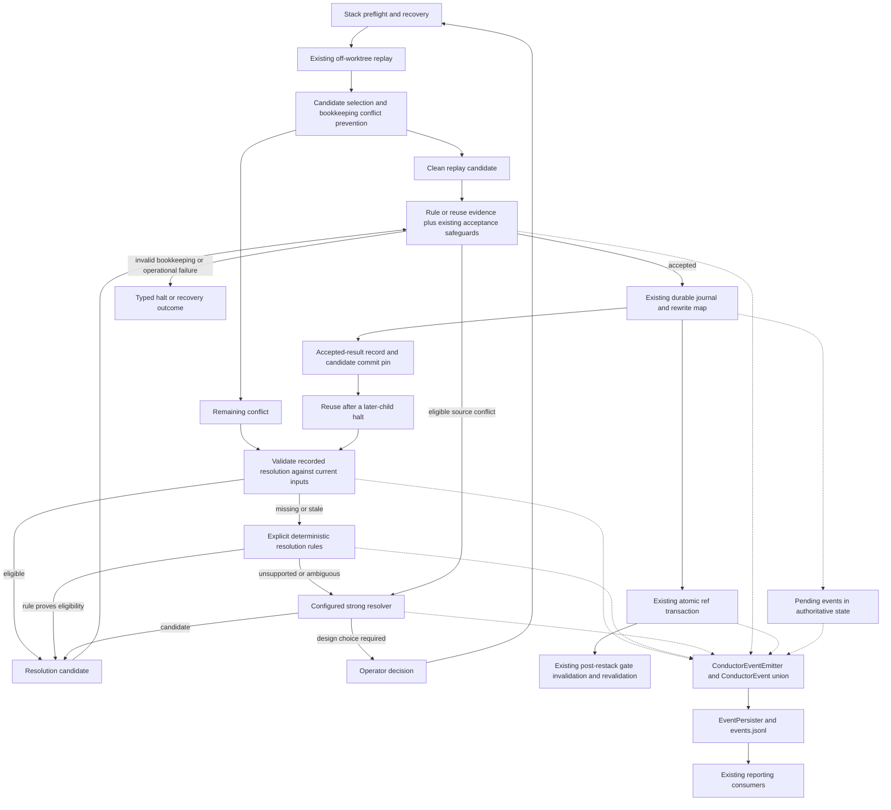
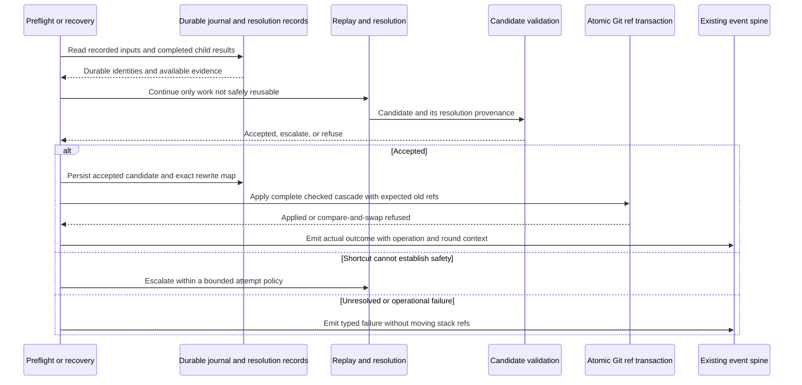

# Components and sequence: Mechanical restack resolution

**Last updated:** 2026-11-15
**Scope:** Proposed extension of stacked replay and recovery for #3632; operator-approved component boundaries, with implementation ownership recorded in the 12-task plan.

## Component diagram

## Interrupted-operation sequence

## Legend

Solid arrows show control or authoritative state flow. Dotted arrows show reporting through the existing event spine. Durable records remain authority; events describe occurrences. Existing modules are extended rather than introducing a second replay engine or telemetry channel.

## Verified basis

- `restack-executor.ts` and `restack-recovery.ts` already consume recorded resolutions and invoke ownership checks.
- `restack-replay.ts` already handles selected bookkeeping conflicts and selects replay candidates.
- `restack-journal.ts` persists child state, exact rewrites, and routed-round context.
- `restack-ownership.ts` checks path ownership and selected parent reverts. These checks do not prove arbitrary behavioral equivalence.
- The approved journaled-replay ADR requires off-worktree computation and atomic ref application; those boundaries remain.

## Boundaries for architecture review

The approved ADR and plan define deterministic eligibility, exact automatic-reuse identity, bounded escalation, and evidence required before application. Candidate commits are pinned as Git objects; JSON references alone do not retain them. Accepted-state event delivery uses the existing persister and durable outbox pattern. It must distinguish rejected shortcut candidates from exhausted strong-resolver attempts so the diagram's escalation edge cannot form an unbounded loop. Existing post-restack validation does not substitute for the requested before-application safety checks.

Generic adjacent-line union and blanket union of `.memory/` files are not approved rules. Memory storage-policy changes require separate operator approval. Recorded answers cannot be reused merely because conflict text resembles a prior conflict. No new small-model tier is included.

Per-round reporting must distinguish completed resolutions, rejected candidates, reuse, provider attempts, and failures without double-counting resumed operations. Historical intake costs are not a forecast of savings. Operational failures remain explicit outcomes even when no design choice is needed.

## Change Log

| Date | Change | Reason |
| --- | --- | --- |
| 2026-11-15 | Initial component and recovery diagrams | Approved comprehensive Approach A |
