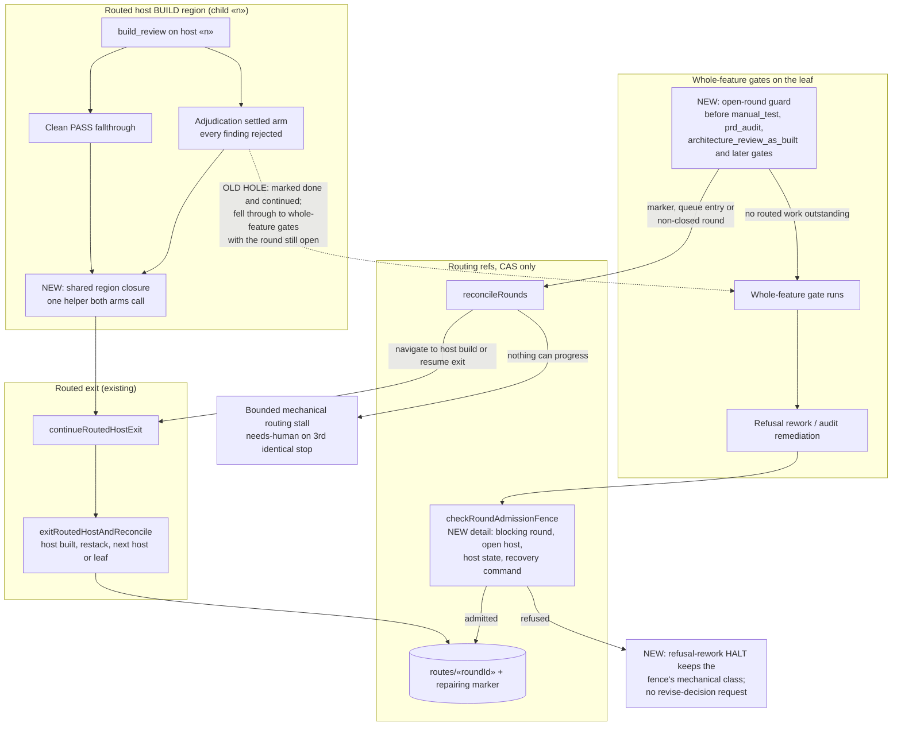
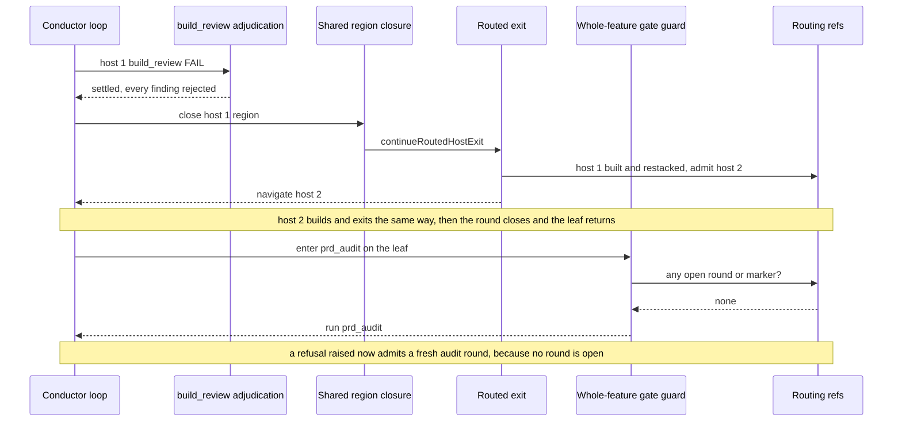

# Components: Routed Host Exit on Every Settled Review, and No Whole-Feature Gate During an Open Round (#3597)

**Last updated:** 2026-11-07
**Scope:** How a routed host's BUILD region ends, and when whole-feature gates may run on a stacked
feature. Covers the build_review completion arms in `conductor.ts` (clean PASS fallthrough and
the adjudication `settled` arm), `continueRoutedHostExit` → `exitRoutedHostAndReconcile`, the
whole-feature gate entry in the conductor loop, `checkRoundAdmissionFence` in
`routing/round-admission.ts`, and refusal rework's HALT writer (`writeRefusalReworkHalt`).

## Diagram

## Sequence: a host whose build_review settles by adjudication

## Legend

- **NEW**: behavior this feature adds. **OLD HOLE**: the path observed on
  `path-policy-still-decides-feature-ownership-by-fol` (round r2, host 1) that this feature closes.
- **Shared region closure**: the existing child-region closure that today runs only on the clean
  PASS fallthrough, moved behind one helper so the adjudication `settled` arm reaches the same
  routed exit (adr-2026-10-12-routed-whole-feature-repair D13).
- **Open-round guard**: the enforcement point for D15 (leaf gates re-run only once no marker or
  queue entry remains). It also covers a resume that lands on a whole-feature gate while a round
  is open. A feature with no open round passes straight through, unchanged.
- **Refusal-rework HALT**: a fence refusal is an engine stop, not an operator decision. It keeps the
  fence's `mechanical` class (D7, #3445 amendment) and names the round, host, host state and an
  executable recovery, instead of re-asking the operator to revise an already-recorded refusal.
- No new module, dependency, ref, or persisted format is introduced.

## Change Log

| Date | Change | Reason |
|------|--------|--------|
| 2026-11-07 | Initial generation | #3597 DECIDE: settled build_review skipped the routed exit; refusal rework hit the open-round fence |
| 2026-11-07 | Plan update: the guard tests any outstanding routed work (marker, queue entry or non-closed route record) through one shared `routedWorkOutstanding`, and runs at the top of the step loop, so resume is covered | Conflict check and plan (D7 amendment by #3597) |
