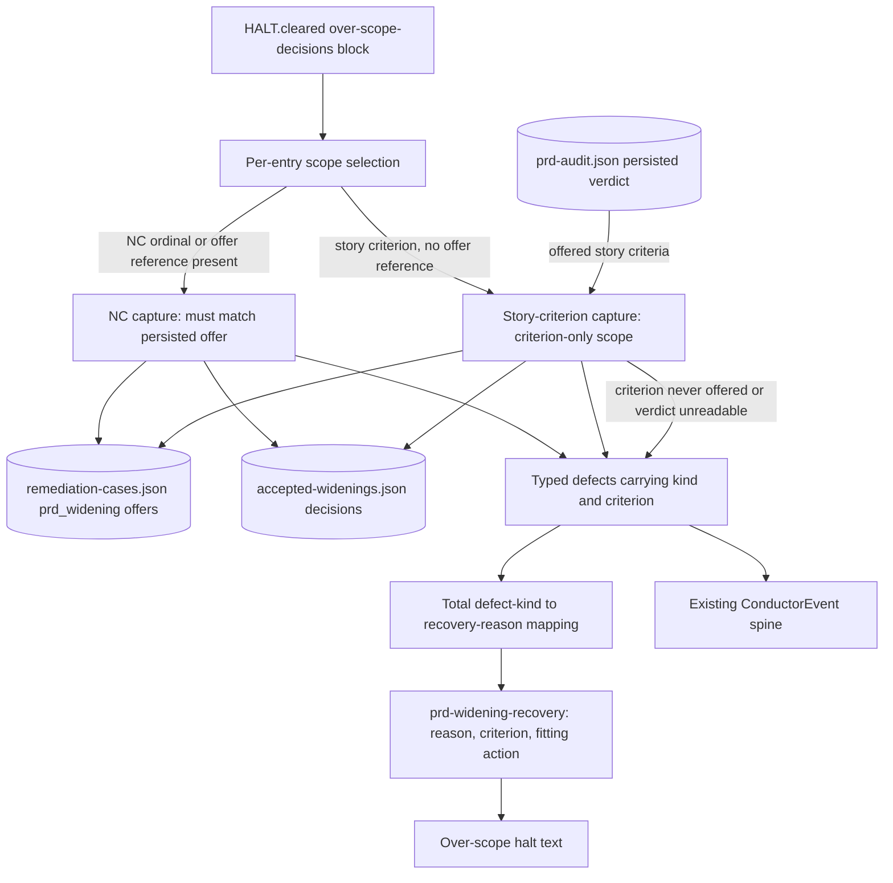
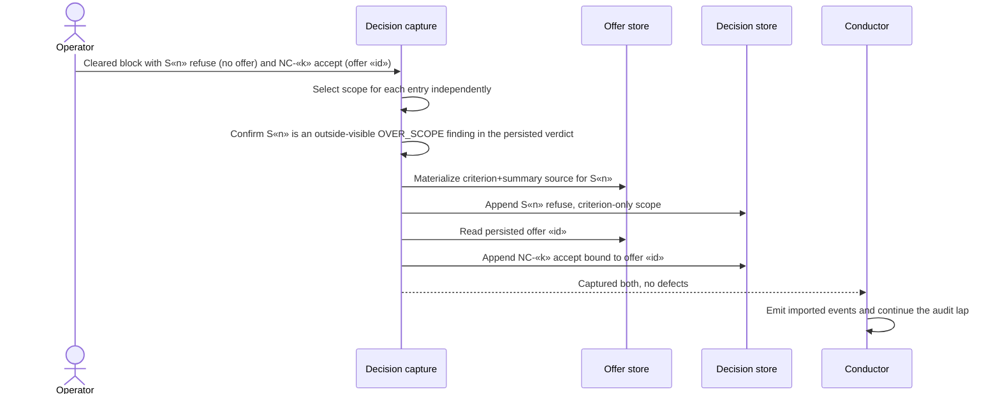
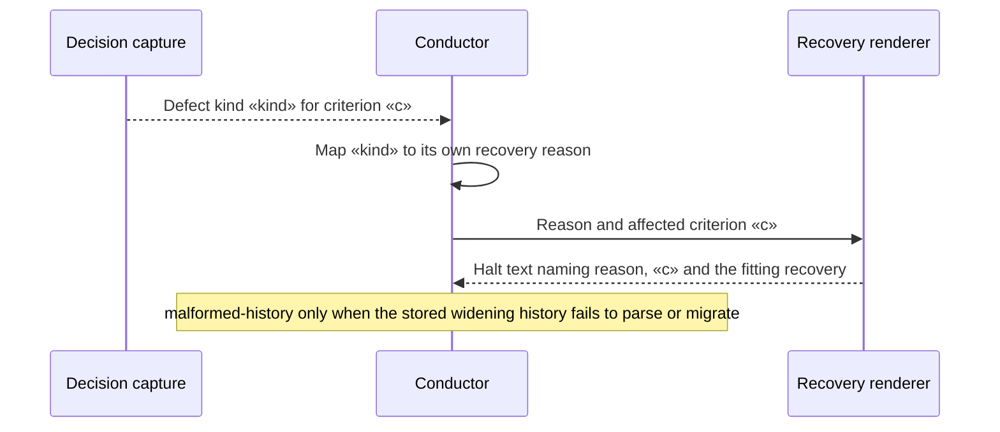

# Components and sequences: Per-entry over-scope decision capture

**Last updated:** 2026-10-31
**Scope:** #3548. Capture of a cleared over-scope decision block at PRD-audit entry and the halt recovery it renders. NC semantic reconciliation, the case-store schema, and classification projection are unchanged.

## Component diagram

## Mixed block: new story criterion refused, prior NC accepted

## Rejected entry: named reason, criterion and recovery

## Legend

- **Story criterion:** a story-numbered acceptance criterion such as `S3.17`. Its decisions keep criterion-only scope (adr-2026-09-07 D1).
- **NC:** a no-owner ordinal such as `NC-2`. It is relabeled each lap, so its decision binds to an engine-stamped offer.
- **Offer:** the engine-persisted case written before an editable entry is rendered, holding the stable `offerEntryId` and a frozen source snapshot.

## Change Log

| Date | Change | Reason |
|------|--------|--------|
| 2026-10-31 | Initial generation | #3548: per-entry capture scope and per-kind recovery reasons |
| 2026-10-31 | Added persisted-verdict offered-set check | Conflict-check resolution: a story criterion the halt never offered is refused |
