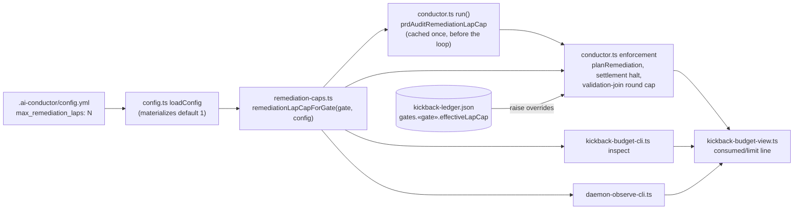
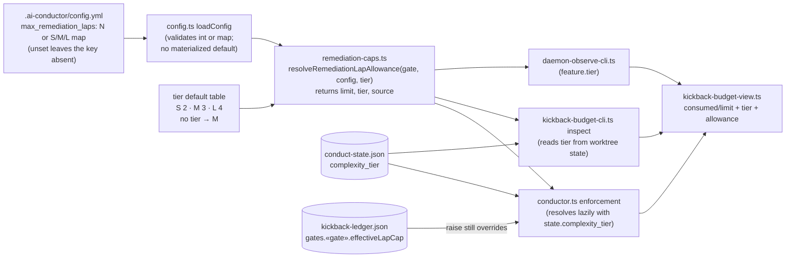
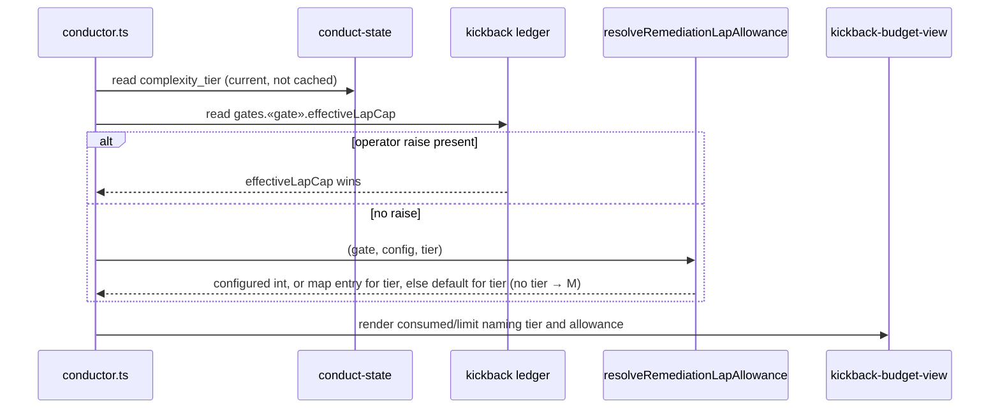

# Components: Tier-derived remediation lap caps

**Last updated:** 2026-10-25
**Scope:** How the `prd_audit` and `architecture_review_as_built` remediation lap allowance is
resolved and consumed, before and after making it derive from the feature's complexity tier
(intake #2413).

## Diagram

### Before (flat integer, materialized at load)

### After (tier-aware, resolved at each use)

### Resolution at a lap-cap check

## Legend

- Cylinders are persisted per-feature state under the worktree's `.pipeline/`.
- `«gate»` is `prd_audit` or `architecture_review_as_built`.
- Precedence is operator raise > configured integer or the map's entry for the tier > tier
  default. A feature with no recorded tier resolves as M.
- No new module, state file, or ledger field is introduced; the resolver signature widens and
  its callers pass the tier.

## Change Log

| Date | Change | Reason |
|------|--------|--------|
| 2026-10-25 | Initial generation | Tier-derived remediation lap caps (#2413) |
| 2026-10-25 | Plan update: name the resolver `resolveRemediationLapAllowance` and its `{ limit, tier, source }` result | `/plan` Technical Approach |
