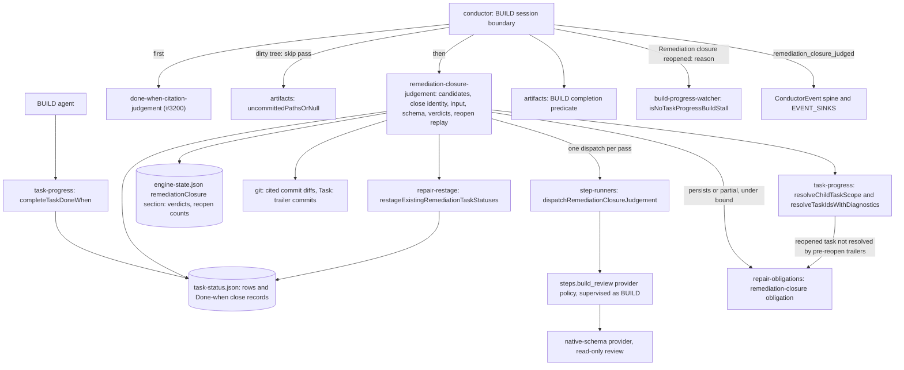

# Components: Completed remediation tasks judged against their named change

**Last updated:** 2026-10-23
**Scope:** Engine components touched by #3190 and how they connect. The runtime flow is in [the sequence diagram](sequences/remediation-tasks-close-on-a-reported-commit-that-.md).

## Diagram

## Legend

New: a pure `remediation-closure-judgement` module, which owns:
- candidate selection over `rem-*` tasks in the execution child's scope;
- a close identity that excludes record sources and rebased SHAs;
- the plan-block-plus-cited-commits input, capped at 48,000 bytes;
- the closed `resolved | persists | partial` schema and its validation;
- verdict application and crash replay.

Also new:
- a versioned `remediationClosure` section of `engine-state.json`;
- the optional `dispatchRemediationClosureJudgement` step-runner port, which resolves its provider policy from `steps.build_review` while supervised as BUILD;
- a `remediation-closure` repair obligation authority;
- the `remediation_closure_judged` event.

Changed:
- the conductor's BUILD boundary runs the new pass after the citation judgement and before the predicate;
- `isNoTaskProgressBuildStall` exempts the `Remediation closure reopened:` prefix;
- repair-obligation supersession includes the new authority within its own authority only.

Unchanged: task close and its close records, the citation judgement, `[test]` provenance, `Task:` trailers as telemetry, `prd_audit`, `build_review`, plan growth, and halt classes.

`adr-2026-10-21-remediation-closure-judgement` governs, with the #3190 amendments to `adr-2026-08-22-done-when-evidence-at-task-close` (D19) and `adr-2026-09-06-reopened-task-resolution` (decision 14).

## Change Log

| Date | Change | Reason |
|------|--------|--------|
| 2026-10-23 | Initial component view | #3190: remediation tasks closed on a reported commit that never implemented them |
