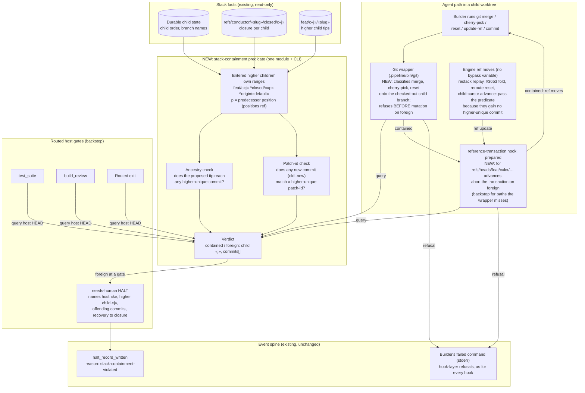

# Components: Stack Containment Guard — a Lower Child Never Gains a Higher Child's Commits (#3676)

**Last updated:** 2026-11-15
**Scope:** How a stacked feature keeps each child branch free of commits unique to a higher child.

The guard is one shared stack-containment predicate, enforced at three layers:

1. the agent-path git wrapper (`engine/git-guard.ts`, `GIT_GUARD_SCRIPT`), which refuses before anything mutates;
2. the worktree `reference-transaction` hook (`engine/git-hook-assets.ts`), which vetoes the ref move in the `prepared` stage;
3. the routed host gates (`test_suite`, `build_review`, `routing/routed-exit.ts`), where a failure halts as a backstop.

There is no bypass variable. Engine ref moves, the journaled restack replay and the `#3653` fold among them, pass because they gain no higher-unique commit (`adr-2026-11-15-stack-children-never-gain-higher-child-commits` decision 4). Routing (`selectHost`, owner derivation, prerequisite claims) is unchanged, and so is leaf execution from `#3653`.

## Diagram

## Legend

- **NEW** marks behavior this spec adds. Everything else already exists and is unchanged.
- `«k»` is the host child's position, and `«j»` is any child above it.
- **Higher-unique set:** the own ranges of every **entered** higher child (`feat/c«j» ^closed/c«p» ^origin/«default»`, where `p` is `j`'s predecessor position from the positions ref, since positions may have gaps). A child is entered once its predecessor position's closure exists, and an unentered child contributes nothing. Only `feat/c«k»` branches are checked; the leaf branch (top position) never is.
- **Foreign:** a proposed tip either reaches a higher-unique commit (merge, fast-forward, reset, `update-ref`), or adds a commit whose patch-id equals one of them (a copy).
- **Patch mode runs only at the gates.** The wrapper checks cherry-pick arguments by identity, and the hook checks ancestry only.
- **Hook-layer refusals stay on stderr**, like every worktree hook. A gate refusal reaches the spine through the existing `halt_record_written` event.
- The wrapper refuses before git touches the index or worktree. A `prepared` veto in `reference-transaction` happens after git has updated the index and worktree (verified on git 2.53), which is why it is only the backstop.
- The gate backstop catches anything that bypassed both layers, such as `--no-verify` or a direct hooksPath override, before a lower child's gates can pass on the wrong tree.

## Change Log

| Date | Change | Reason |
|------|--------|--------|
| 2026-11-15 | Own-range definition; leaf never checked | conflict-check C1–C3 (creation, first pass, leaf-executed hosts) |
| 2026-11-15 | Initial generation | #3676: a repair host merged child 4 into child 2 and no guard refused it |
