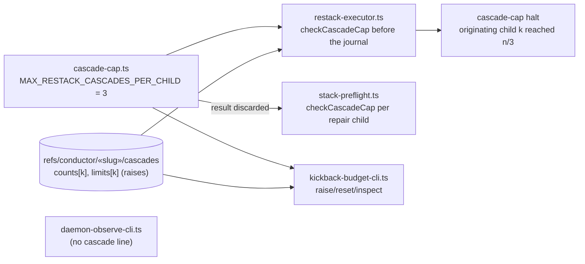
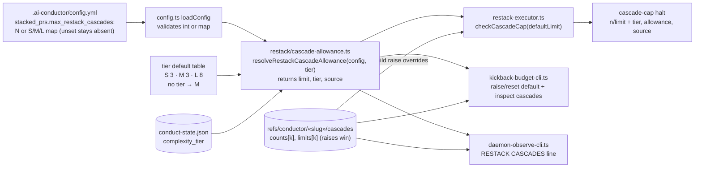
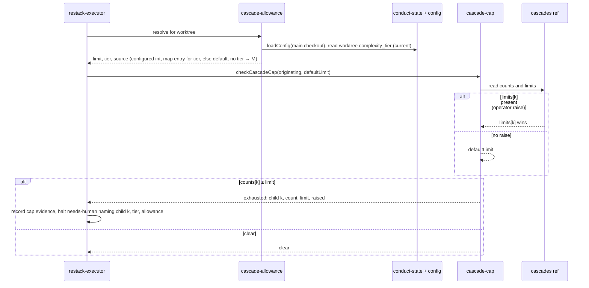

# Components: Tier-sized restack cascade allowance

**Last updated:** 2026-10-28
**Scope:** How the per-originating-child restack cascade allowance is resolved, enforced, recovered
and displayed, before and after sizing it by the feature's complexity tier (intake #3472). Builds
on #3475, where a restack limit belongs to the originating child in the `cascades` ref and the cap
evidence snapshots it.

## Diagram

### Before (one constant for every tier)

### After (tier-sized, resolved at each use)

### Resolution at a feature-repair restack

## Legend

- Cylinders are durable state: `conduct-state.json` is the feature-wide document in the worktree's
  `.pipeline/`; the `cascades` blob ref survives worktree recreation.
- `k` is an originating child. Precedence for child k: a `limits[k]` written by an operator raise,
  then the configured integer or the map's entry for the feature's tier, then the tier default.
- A feature with no recorded tier resolves as M.
- One new pure module; no new ref, ledger field or event. The stack preflight's pre-check, whose
  result was discarded, is removed; `runRestack` is the single enforcement site.

## Change Log

| Date | Change | Reason |
|------|--------|--------|
| 2026-10-28 | Initial generation | Tier-sized restack cascade allowance (#3472) |
