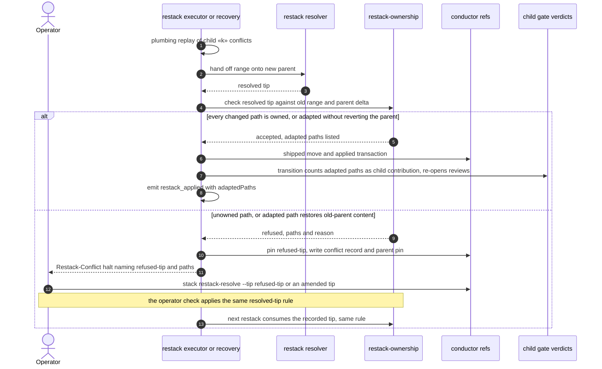
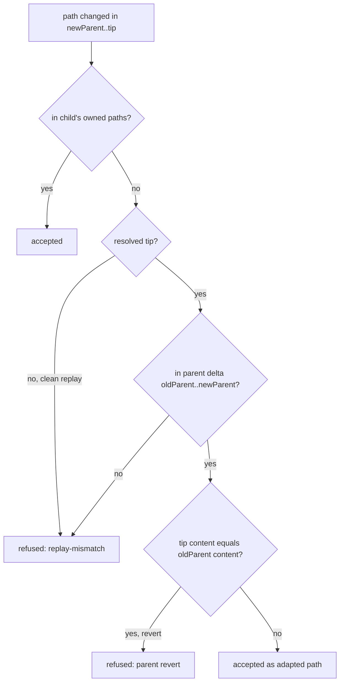

# Sequence: Restack accepts resolutions that adapt the new parent's files (#3598)

**Last updated:** 2026-11-07
**Scope:** path-ownership acceptance of a *resolved* restack tip in `runRestack`, journal recovery (`restack-recovery.ts`), and the operator `stack restack-resolve --tip` check. A clean plumbing replay keeps the shipped strict rule. Sequenced after #3438, whose resolver hand-off this builds on.

**What changes:**
- **Two acceptance rules.** A clean replay is still accepted only when `newParent..newTip` paths are a subset of the child's owned paths. A resolved tip, from the resolver, an operator `--tip`, or recovery of either, may also change paths in its new parent's delta (`oldParent..newParent`). Those paths are the tip's *adapted paths*.
- **Revert guard.** An adapted path is refused when the tip's content at that path equals the old parent's content, including the path's absence when the parent added it. That is a revert of the parent's change, not an adaptation of it.
- **Scope guard.** A path in neither the owned set nor the parent delta is still refused `replay-mismatch`.
- **Re-review.** Accepted adapted paths are carried on `restack_applied` as `adaptedPaths`. The shipped transition comparison measures a child's contribution by its old owned paths only, so an edit confined to parent-delta paths would read as an unchanged replay and preserve `build_review`. The transition therefore recomputes the adapted paths from the same formula and counts them as part of the child's contribution, which re-opens the child's feature-scoped reviews so `build_review` judges each adaptation. Nothing new is persisted in the journal.
- **Refused tips are kept.** A refused resolver tip is pinned at `refs/conductor/«slug»/restack/conflict/refused-tip`. The refusal writes the shipped conflict record and `Restack-Conflict:` halt, whose detail names the ref and the refused paths, so `restack-resolve --tip` can reuse or amend the tip. The ref shares the conflict record's lifecycle.

**Built on shipped code:** `checkPathOwnership`, `ownedPaths`, `parentOverlapPaths`, `haltUnresolvedConflict`, `haltRecordedRestackConflict`, `writeConflictRecord`, `pinStagingRef`, `consumeRecordedResolution`, `checkRestackResolution`, and `applyRestackTransition`.

## Diagram

## Legend

- **Owned paths:** `diff --no-renames --name-only oldParent oldTip`, less a carried merge's automatic paths (adr-2026-10-10-stacked-restack-journaled-replay decision 3).
- **Parent delta:** `diff --no-renames --name-only oldParent newParent`.
- **Resolved tip:** a tip produced by the restack resolver, recorded by `stack restack-resolve --tip`, or either consumed through journal recovery. Not a clean plumbing replay.
- **«slug»:** the stacked feature's slug.

## Change Log

| Date | Change | Reason |
|------|--------|--------|
| 2026-11-07 | Initial generation | #3598: resolved restack tips may adapt the new parent's files under a revert guard; refused tips are pinned and recoverable |
