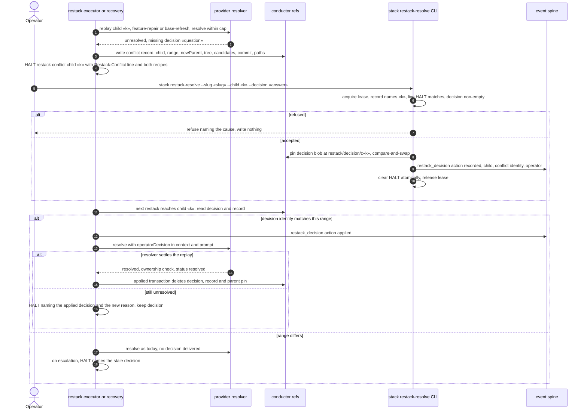
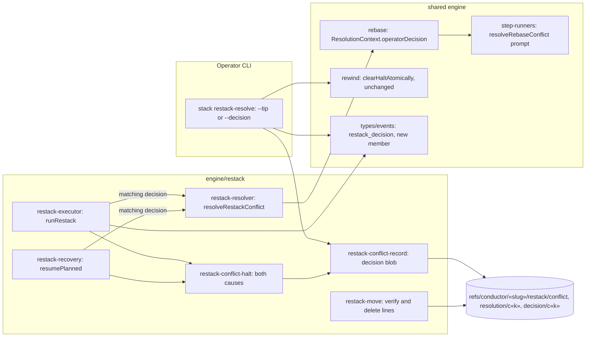

# Sequence + Components: Deliver an operator decision to the stacked restack resolver (#3478)

**Last updated:** 2026-10-31
**Scope:** the stacked restack conflict hand-off that #3421 shipped as #3522
(`adr-2026-10-25-operator-recorded-restack-conflict-resolution`). This spec extends it in three
ways and fixes one adjacent defect:

- **A written decision instead of a tip.**
  - **Command.** `ai-conductor stack restack-resolve --slug «slug» --child «k» --decision «answer»`
    is the sibling of `--tip`. The two flags are mutually exclusive.
  - **Shared machinery.** It runs under the same feature dispatch lease and the same check that the
    conflict record matches the live HALT. It uses the same atomic HALT clear.
  - **Storage.** Instead of a resolved tip, it pins a decision blob at
    `refs/conductor/«slug»/restack/decision/c«k»`. The blob is bound to the conflict's identity:
    child, the range's `oldParent` and `oldTip`, the conflicting commit, and its paths. It is not
    bound to the per-run `opId`.
- **The resolver receives the decision.**
  - **When.** At the next restack, a decision whose identity matches the range being replayed is
    passed to the provider resolver: `ResolutionContext.operatorDecision`, then the
    `resolveRebaseConflict` prompt.
  - **Outcomes.** If the resolver then settles the replay, the shipped path applies it unchanged. If
    it still escalates, the new HALT states that the recorded decision was applied and did not
    settle the conflict.
  - **Stale decisions.** A decision whose range no longer matches is not delivered. The restack
    escalates as today and names the stale decision.
- **Base-refresh conflicts get the same hand-off.**
  - **Today.** The conflict record, the `Restack-Conflict` halt line and the recipe are written only
    for `feature-repair` journals.
  - **Change.** A `base-refresh` conflict writes them too, so `--tip` and `--decision` both work for
    either cause.
  - **Candidates.** A base-refresh record's candidate subjects are the resolver's replay
    candidates, which already omit patch-equivalent commits from the new default.
- **Out of scope: the stale `HALT.cleared` body.** It was split to jstoup111/ai-conductor#3551 on 2026-10-31.
  `HALT.cleared` is the prd_audit over-scope carrier, and the daemon clear-watcher reads whether it
  exists to tell a re-kick from an operator clear (`watchHaltCleared` in `daemon-deps.ts`). Neither
  belongs to restack. This spec's `--decision` clear uses the shipped `clearHaltAtomically`
  unchanged.

A decision is consumed by the same lifecycle as a tip. The ready→moved transaction verifies the
decision ref is unchanged. The applied transaction deletes it together with the conflict record
and parent pin. An aborted or halted restack keeps it. Feature teardown deletes it by name.

**Built on shipped code:**
- **Restack engine:** `runRestack`, `resumePlanned`, `haltRecordedRestackConflict`,
  `writeConflictRecord` / `readConflictRecord`, `consumeRecordedResolution`, `resolveRestackConflict`,
  `applyRestackMove`, and `appliedTransactionLines`.
- **CLI:** `dispatchStackRestackResolve`, `checkRestackResolution`, `acquireFeatureDispatchLease`,
  `clearHaltAtomically`, and `featureConductorRefNames`.
- **Events:** a new `restack_decision` member beside the shipped `restack_resolution`, whose required `tip` a decision does not have.

## Diagram: decision, delivery, and escalation

## Diagram: components touched

## Legend

- **Restack executor or recovery:** `runRestack`, or journal recovery's `resumePlanned`. Both reach
  the same conflict halt and the same decision lookup.
- **Conflict identity:** child, range `oldParent` and `oldTip`, conflicting commit, and paths. The
  `opId` is excluded because every restack run mints a new one.

## Change Log

| Date | Change | Reason |
|------|--------|--------|
| 2026-10-31 | Initial generation | DECIDE for #3478 (merged with #3460), building on #3522 |
