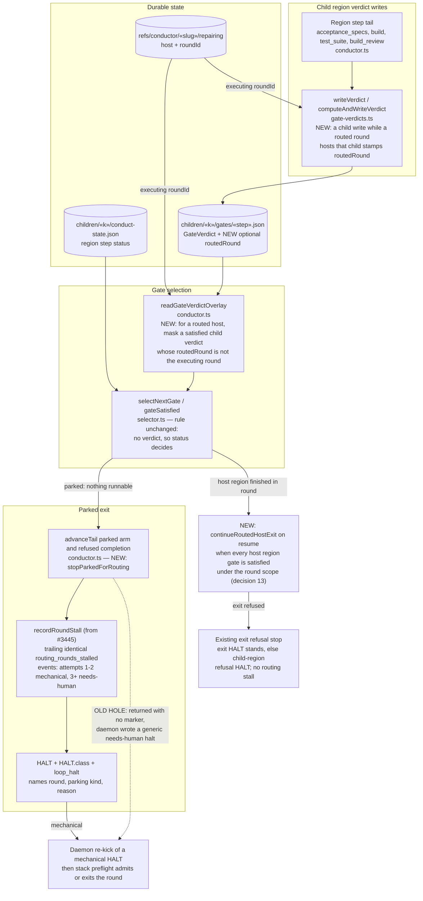
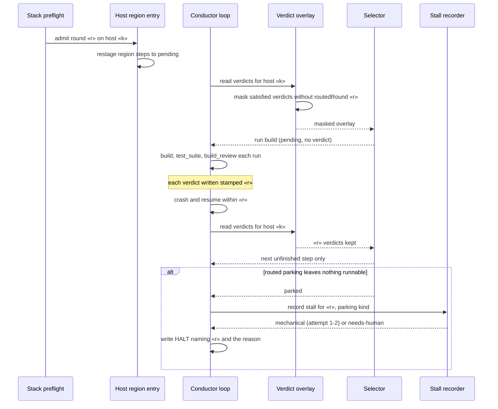

# Components: Round-Scoped Routed Host Verdicts and Classified Parked Exits (#3455)

**Last updated:** 2026-10-28
**Scope:** How a routed host's child region verdicts are written and read, and how the gate-driven
loop stops when routed parking leaves nothing runnable. Covers `gate-verdicts.ts` (`GateVerdict`,
`writeVerdict`), `conductor.ts` (`readGateVerdictOverlay`, `advanceTail`'s `parked` arm, the step
loop's `parkedForRouting` exit), `selector.ts` (`selectNextGate`, unchanged rule), and the bounded
stall machinery `#3445` adds to `routing/round-admission.ts` (`recordRoundStall`,
`routing_rounds_stalled`).

## Diagram

## Sequence: routed round re-enters a host that holds verdicts from an earlier lap

## Legend

- **NEW** marks behavior this spec adds. **OLD HOLE** marks the defect path it closes.
- One conductor resolver, `routedRoundForActiveChild`, supplies the executing round to both the
  verdict stamp and the overlay mask, so the two can never disagree about which round is executing.
- `routedRound` is an optional additive `GateVerdict` field. Flat (N=1) features and non-routed
  child regions never write it and never mask on it.
- Masking applies only to satisfied verdicts and deletes them from the in-memory overlay only; an
  unsatisfied verdict from any round still blocks. Selection then falls back to the
  child's step status, so a re-pended step re-runs and a step finished earlier in the round stays
  `done`.
- `recordRoundStall` and `routing_rounds_stalled` are delivered by `#3445`
  (`routed-repair-opens-a-new-round-while-an-earlier-r`). This spec reuses them rather than adding
  a second retry counter.

## Change Log

| Date | Change | Reason |
|------|--------|--------|
| 2026-10-28 | Initial generation | #3455 round-scoped routed host verdicts and classified parked exits |
| 2026-10-28 | Added the resume exit of a finished host region | Operator included the interrupted-exit gap in #3455 scope |
| 2026-10-28 | A refused resume exit reuses the in-loop refusal stop | Conflict check: restack and preflight exit HALTs keep their own class |
| 2026-10-28 | Named the planned conductor methods | Plan update |
