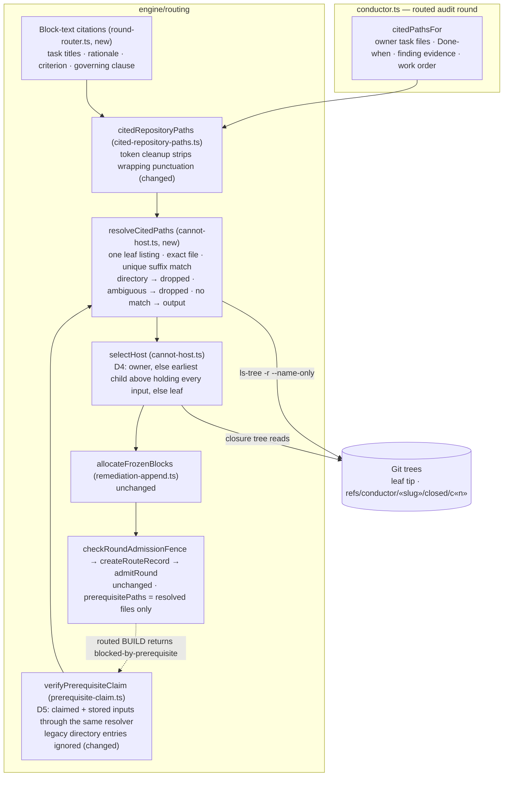
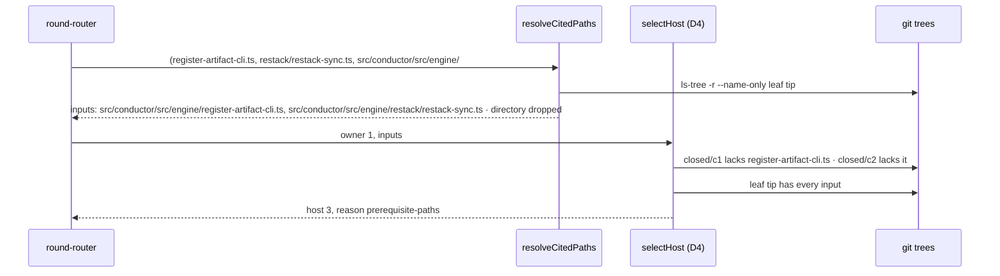

# Architecture: Routed-repair citation resolution

**Issue:** #3550 · **Stem:** `routed-repair-hosts-a-finding-on-a-stack-child-tha` · **Tier:** M (lightweight diagram)
**Last updated:** 2026-10-31
**Scope:** The stacked routed-repair placement path in `src/conductor/src/engine/routing/`: citation
extraction, D4 cannot-host selection and D5 prerequisite-claim verification
(`adr-2026-10-12-routed-whole-feature-repair` decisions 4 and 5). Residue judgement, rem-block
allocation, the route-record schema, the admission fence and markers, routed exit and restack are
unchanged.

## One-line

Every cited path is resolved once against the leaf tree into repository file paths before it can
count as evidence, and a directory or ambiguous citation never counts. The citations include the
text each item's rem blocks will carry. D4 host selection and D5 claim verification read the same
resolved files. Because the leaf holds every resolved input, D4 always finds a host that holds every
file a repair block cites, so the change adds no halt.

## Components

## Placement sequence (the #3550 incident, corrected)

## Legend

- **Changed / new** label a component this spec edits. Every other component keeps its behaviour.
- **Input** — a resolved repository file present at the leaf tip (D4 prerequisite input).
- **Output** — a citation with no leaf match, which the repair creates. Never prerequisite evidence,
  as D4 already states.
- **Dropped** — a citation that names a directory or matches several leaf files. It is neither an
  input nor an output and never satisfies or fails a host check.
- `«slug»`, `«n»` — placeholders for the feature slug and child position.

## Change Log

| Date | Change | Reason |
|------|--------|--------|
| 2026-10-31 | Initial generation | #3550: routed repair hosted a finding on a child lacking its target file |
