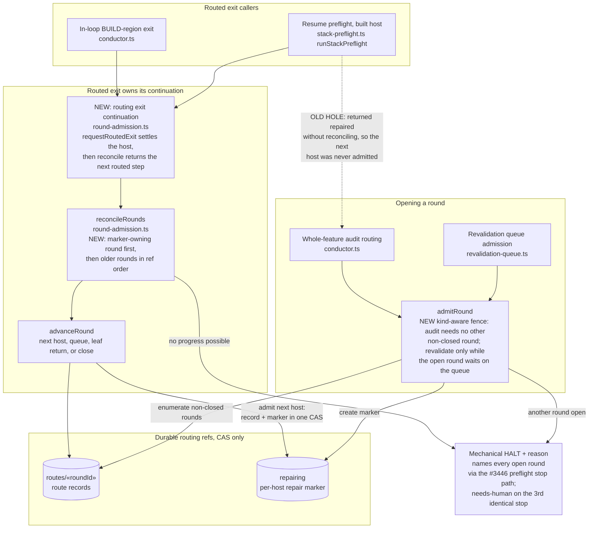
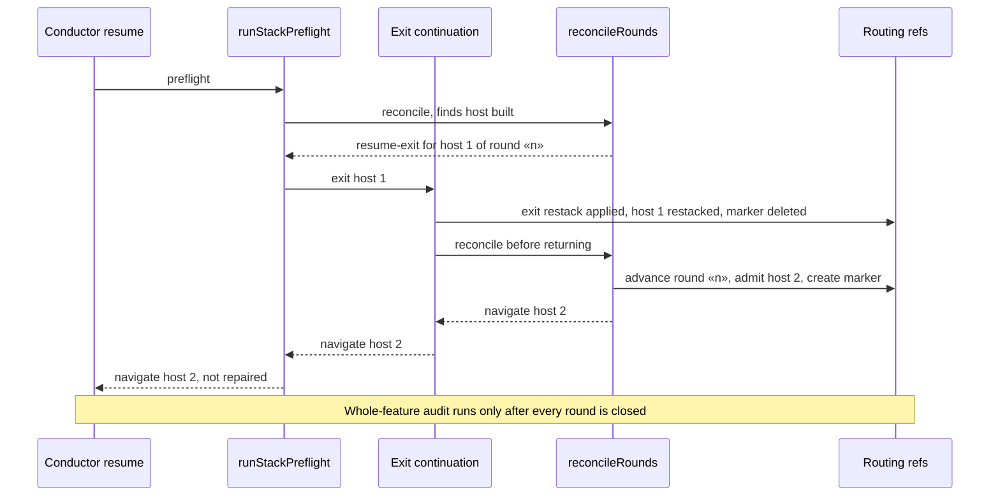

# Components: Routed Round Continuation and Single-Open-Round Invariant (#3445)

**Last updated:** 2026-10-26
**Scope:** How a routed host exit advances its round, how a new routed round is admitted, and how
resume reconciles durable routing state — `routing/routed-exit.ts` (`requestRoutedExit`,
`advanceRound`), `routing/round-admission.ts` (`admitRound`, `reconcileRounds`),
`restack/stack-preflight.ts` (`runStackPreflight`), and the two `conductor.ts` callers (the
in-loop BUILD-region exit and the whole-feature audit routing).

## Diagram

## Sequence: built host resumed after a halt

## Legend

- **Callers**: today the in-loop exit reconciles after the exit and the resume preflight does not.
  One continuation in `round-admission.ts` (exit, then reconcile) gives both callers the same next step;
  it lives there because `round-admission.ts` already imports `routed-exit.ts`, so no import cycle forms.
- **NEW / OLD HOLE** annotations: the behavior changes this feature makes. Everything else is the
  existing seam governed by `adr-2026-10-12-routed-whole-feature-repair` decisions 6 and 7.
- **Repair marker**: a per-host ref deleted at every host exit. It is not a round lock, which is why
  admission must also enumerate non-closed route records.
- **Mechanical HALT**: the daemon re-kicks it without an operator; only the 3rd consecutive identical stop is needs-human. The stop path belongs to #3446.
- `«…»`: placeholder for a variable value.

## Change Log

| Date | Change | Reason |
|------|--------|--------|
| 2026-10-26 | Initial generation | DECIDE for #3445: routed rounds opened while an earlier round was still open |
| 2026-10-26 | Stop node is a mechanical HALT | Conflict C1 with #3458's mechanical live-owner design |
