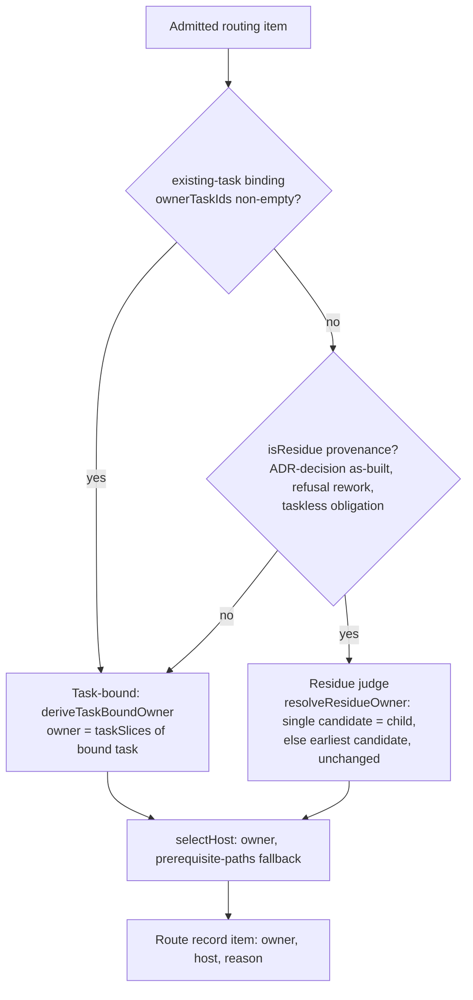
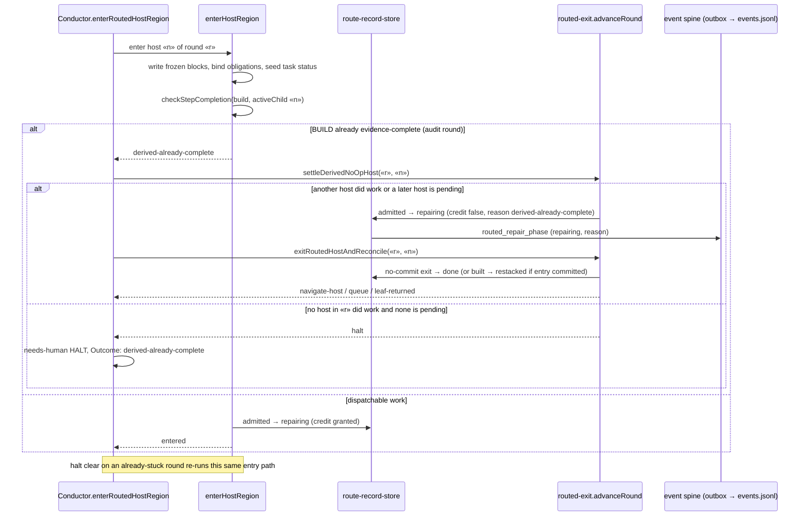

# Sequence: Task-bound residue routing and no-op routed-host settle (#3590)

**Last updated:** 2026-11-05
**Scope:** How an admitted as-built finding is classified for owner routing, and what the conductor
does when a routed audit host has no dispatchable BUILD work at region entry.

## Diagram — owner classification (`routeAdmittedRound`)

## Diagram — routed audit host entry with no dispatchable work

## Legend

- **Task-bound:** owner is derived mechanically from the sealed task-to-slice map
  (`adr-2026-10-12-routed-whole-feature-repair` decision 2). An existing-task binding now takes
  precedence over residue provenance.
- **No-op settle:** reuses existing host states and the routed exit (`exitRoutedHostAndReconcile`); no provider runs and
  no repair credit is charged. The no-op halt is kept only when no host in the round did work.

## Change Log

| Date | Change | Reason |
|------|--------|--------|
| 2026-11-05 | Initial generation | #3590 DECIDE |
| 2026-11-05 | Named `settleDerivedNoOpHost` and the routed-exit continuation | #3590 plan update |
