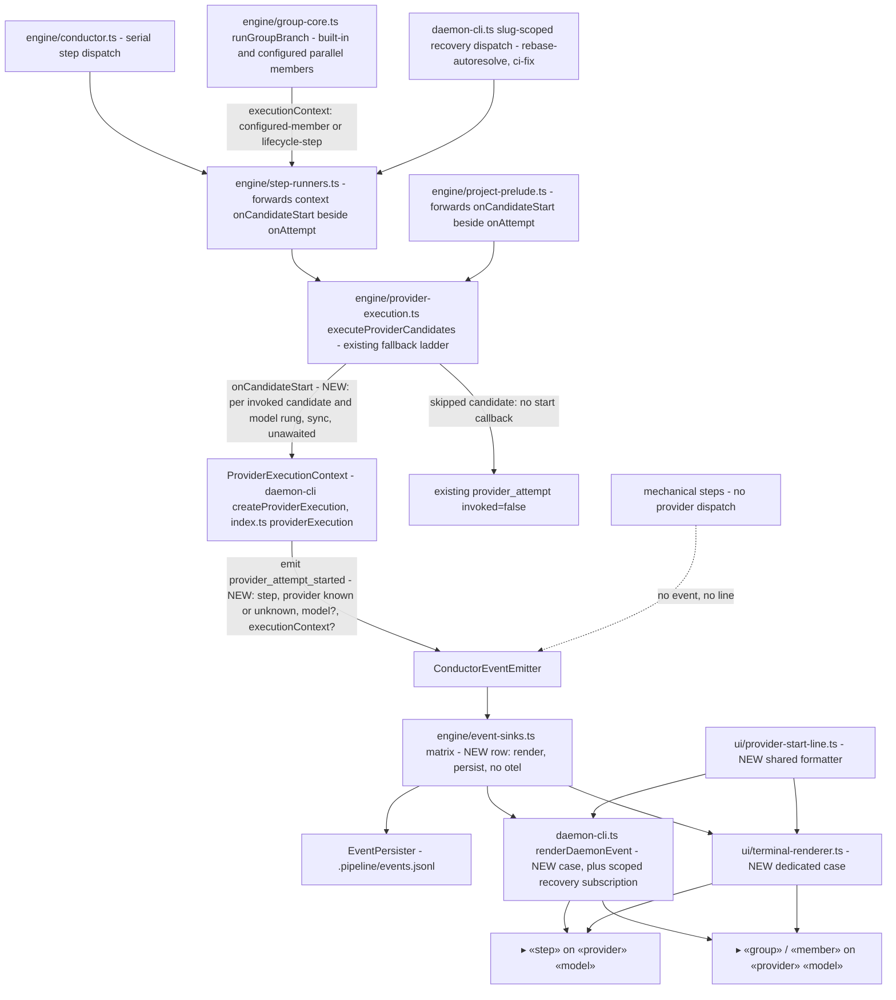
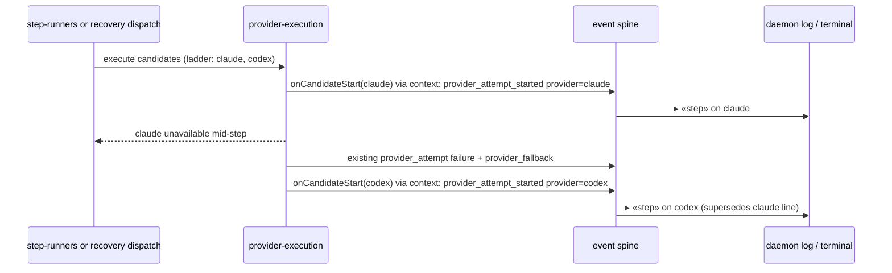

# Components: Live provider identification per attempt (#1268)

**Last updated:** 2026-10-14
**Scope:** The path from per-candidate provider dispatch to the two live operator surfaces (daemon
log and interactive terminal renderer), for serial steps and parallel-group members. Provider
routing, fallback policy, and the daemon status dashboard are unchanged.

## Diagram

## Fallback sequence

## Legend

- **NEW** marks what this feature adds; unmarked nodes already exist on `main`.
- **onCandidateStart** lives on the executor input beside `onAttempt` and fires once per candidate
  and model rung that is actually invoked, after every skip decision and before the provider process
  runs. It is separate from the stream observer, which is never created on the interactive (REPL)
  path, so the start signal is not lost there. It sits at the executor rather than in `step-runners`
  because the project prelude calls the executor directly. It fires inside the per-rung runtime
  call, so a cached rubric result never announces a provider.
- **executionContext** is already an input of `executeProviderCandidates` and is passed through to the
  start callback exactly as it reaches `onAttempt`, so a configured member renders as
  `«group» / «member»` and concurrent members stay distinct.
- **unknown:** if the candidate key cannot be resolved to a provider name the event carries an
  explicit unknown value and the renderers print `provider unknown`; renderers never fall back to
  a previous line's provider.
- **Historical records** lack the new variant; readers that do not recognize it skip it, so old
  `events.jsonl` files stay readable.

## Change Log

| Date | Change | Reason |
|------|--------|--------|
| 2026-10-14 | Initial generation | #1268 live provider identification spec |
| 2026-10-14 | Emission moved to the executor callback boundary; recovery path, shared formatter, no-otel sink row | Plan-time verification and plan review: the project prelude bypasses step-runners; rubric cache hits must not announce |
