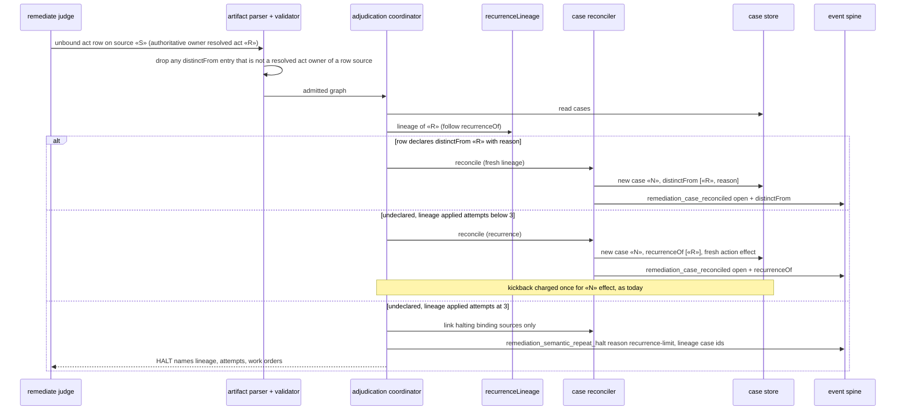

# Sequence: unbound act re-raise over a resolved act case

**Last updated:** 2026-10-23
**Scope:** The build_review lap path for jstoup111/ai-conductor#3124: undeclared recurrence, declared
distinct, and an exhausted lineage.

## Diagram

## Legend

- «R» is unchanged in every branch.
- The cap check runs before reconciliation reserves any sibling effect, like the existing
  regression halt does.

## Change Log

| Date | Change | Reason |
|------|--------|--------|
| 2026-10-23 | Initial sequence | #3124 recurrence lineage |
