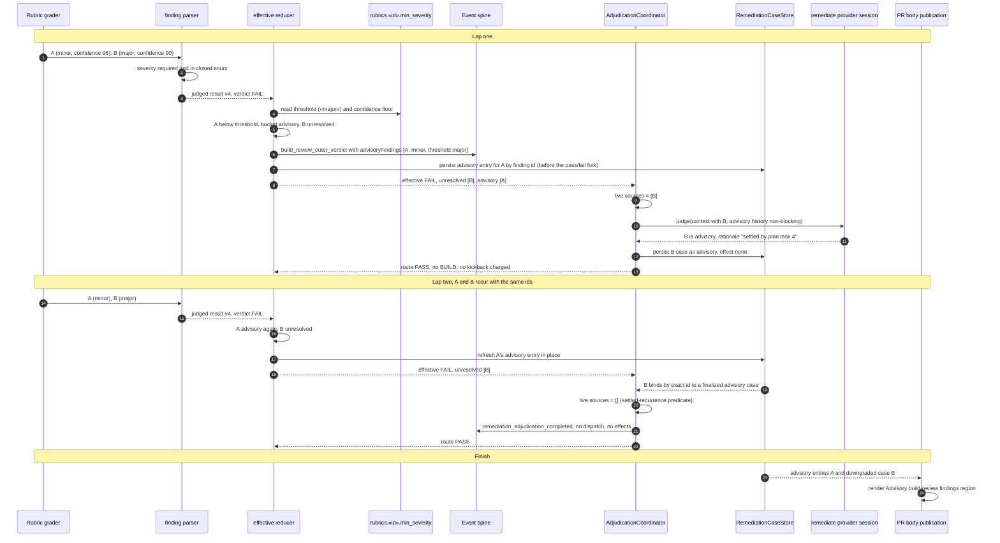

# Sequence: a minor finding is advisory and a downgraded finding stays advisory

**Last updated:** 2026-10-19
**Scope:** Two consecutive build_review laps for one feature, with
`build_review.rubrics.implementationQuality.min_severity: major`.

- **Lap one:** a minor finding is classified advisory by the threshold. A major finding is
  adjudicated and downgraded to advisory.
- **Lap two:** both findings recur by exact id and the lap finalizes with no remediate dispatch.

Companion to `.docs/architecture/build-review-findings-carry-a-severity-with-a-per-.md`.

## Diagram

## Legend

- **Threshold advisory (A)** never reaches the coordinator, is never judged, and never charges the
  kickback budget. It appears on the spine, in durable history, in the CLI and on the PR.
- **Adjudicator advisory (B)** costs one remediate dispatch, the same as a defer does today. Once
  finalized, the settled-recurrence predicate keeps it from being re-judged while its id is stable.
- **Had B's id drifted**, it would be a live source again and the judge would run. Id drift is #3294
  and is out of scope here.
- **With no `min_severity` configured**, A would be unresolved and both findings would reach the
  judge, as they do today.

## Change Log

| Date | Change | Reason |
|------|--------|--------|
| 2026-10-19 | Initial generation | Authored during DECIDE for jstoup111/ai-conductor#3298 |
