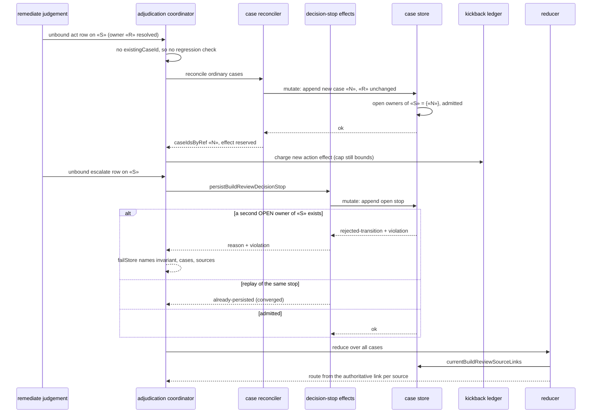

# Sequence: unbound re-raise of a resolved case's source

**Last updated:** 2026-10-19
**Scope:** One build_review lap in which the remediate judgement re-raises source «S», which only a
resolved case «R» owns, as a new act case and as a new escalation (the two shapes in #3292).

## Diagram

## Legend

- «R» is resolved history and stays byte-identical. «N» is the new case. «S» is the shared source id.
- The open-open refusal is unchanged; only resolved owners stop counting.

## Change Log

| Date | Change | Reason |
|------|--------|--------|
| 2026-10-19 | Initial generation | #3292 DECIDE (Medium) |
