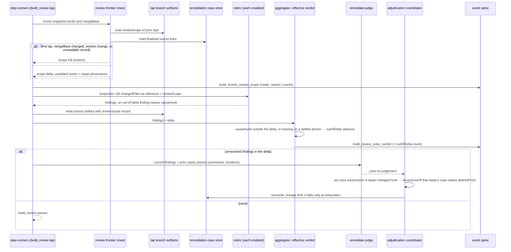

# Sequence: a later build_review lap judges only the unsettled delta

**Last updated:** 2026-10-24
**Scope:** One build_review lap after a repair, for jstoup111/ai-conductor#3294. It shows how the
scope is decided, how a rubric judges the delta, how out-of-delta findings are admitted, and how
repair provenance joins the #3124 lineage.

## Diagram

## Legend

- **Settled** means a hunk was reviewed by an earlier lap and every finding on it reached a
  finalized case: defer, reject, refute, advisory, merged, carried, or a resolved act. A changed
  hunk has a new content hash, so it is never settled.
- **Repair provenance** maps each delta hunk to the act cases applied since the predecessor lap that
  have a source anchored on the same path. It does not use commit trailers, which are telemetry
  only (#773).

## Change Log

| Date | Change | Reason |
|------|--------|--------|
| 2026-10-24 | Initial sequence | #3294 lap-monotonic build_review scope |
