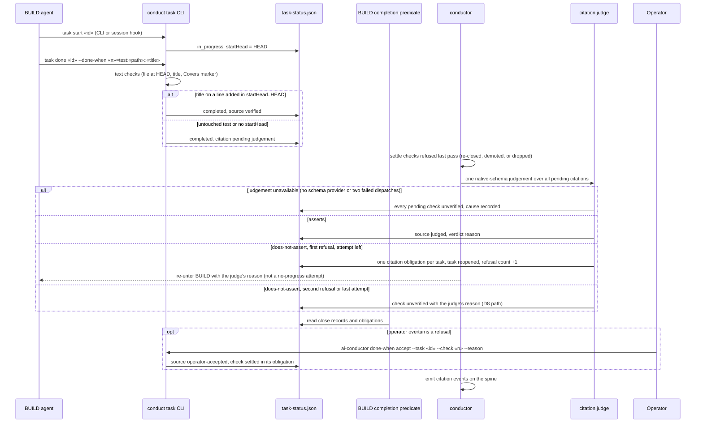

# Sequence: `[test]` citation close, BUILD-boundary judgement, and operator acceptance

**Last updated:** 2026-10-21
**Scope:** Runtime flow for #3200, from `conduct task start` through close, the BUILD-boundary judgement, reopen, and the operator lever. Components are in [the component view](../done-when-closes-as-verified-citing-tests-that-don.md).

## Diagram

## Legend

`startHead` is the commit recorded when the task started. A judgement dispatch that fails (provider failure or schema-invalid output) is a failed dispatch, not a refusal, and never consumes the bound. A task reopened by a refusal is not counted as resolved through its `Task:` trailers.

## Change Log

| Date | Change | Reason |
|------|--------|--------|
| 2026-10-21 | Initial sequence | #3200 |
