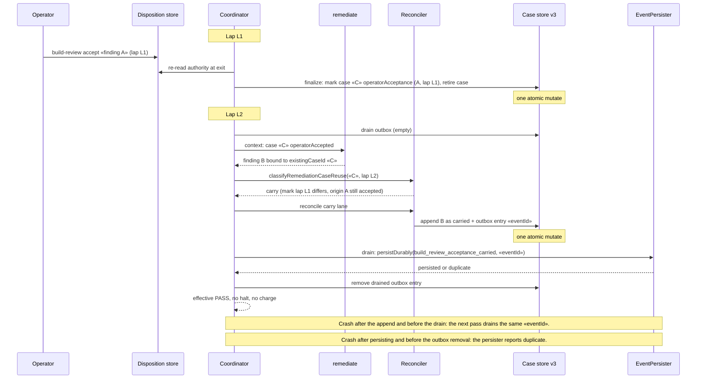

# Sequence: an accepted finding is re-raised, carried and announced

**Last updated:** 2026-10-21
**Scope:** Lap L1 accepts a finding. Lap L2 re-raises the same substance under a new id and the
adjudicator binds it to the same case. A crash can occur between any two steps.

## Diagram

## Legend

`«C»` is the accepted case and `«eventId»` is engine-stamped in the same transaction as the link.

## Change Log

| Date | Change | Reason |
|------|--------|--------|
| 2026-10-20 | Initial generation | Respec of #3271 after revert #3319 |
| 2026-10-21 | Plan-update: carry event renamed `build_review_acceptance_carried` to match the ADR | /plan for the #3271 respec |
