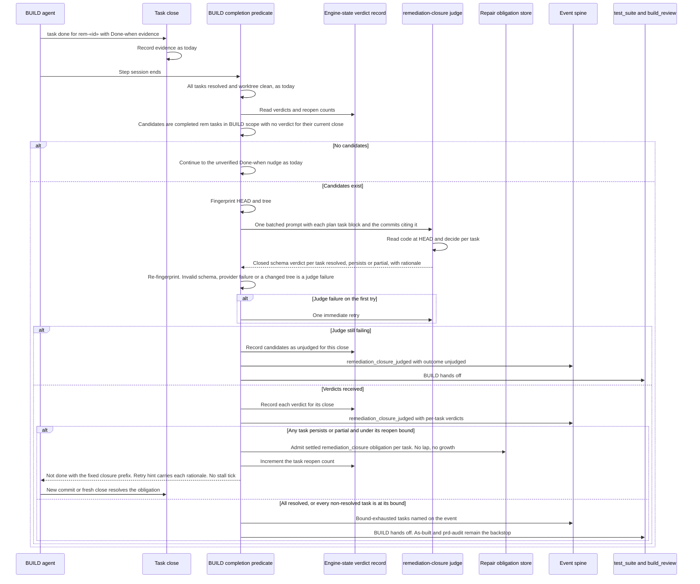

# Sequence: A closed remediation task is judged against its finding before BUILD hands off

**Last updated:** 2026-10-21
**Scope:** How BUILD's completion predicate judges each completed engine-appended `rem-*` task against the change its plan block names, reopens a task whose finding still holds, and bounds both reopens and judge failures. Ordinary plan tasks, `[test]` verification at task close, and the unverified Done-when nudge are unchanged.

## Diagram

## Legend

A candidate is a task whose id passes `isEngineAppendedRemediationTaskId`, sits in the current BUILD task scope (including a routed host child's scope), and is resolved without a recorded verdict for its current close identity. Because a judged task is never re-judged until it closes again, one commit may legitimately close several tasks: each task is judged on its own plan block. The plan task block (title, Rationale, Criterion, Governing clause) is the authority for the change the task names; no gate finding is re-persisted. The judge dispatches through the existing auxiliary provider boundary under the `build_review` step's provider policy, so the builder does not grade its own work. The reopen bound is two reopens per task. A reopened task needs a repair obligation because its earlier `Task:` trailer would otherwise resolve it again immediately (adr-2026-09-06-reopened-task-resolution D4).

## Change Log

| Date | Change | Reason |
| --- | --- | --- |
| 2026-10-21 | Initial sequence | #3190: remediation tasks closed on a reported commit that never implemented them; the next audit lap found the findings persisted |
