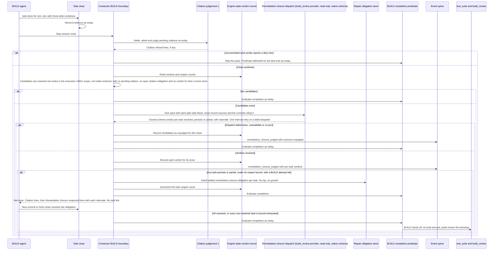

# Sequence: A closed remediation task is judged against its named change before BUILD hands off

**Last updated:** 2026-10-23
**Scope:** How the conductor's BUILD session boundary, straight after the #3200 citation judgement, judges each completed engine-appended `rem-*` task against the change its plan block names, reopens a task whose change is absent, and bounds both reopens and failed dispatches. Ordinary plan tasks, `[test]` verification at task close, the citation judgement itself and the unverified Done-when nudge are unchanged.

## Diagram

## Legend

A candidate is a task whose id passes `isEngineAppendedRemediationTaskId`, sits in the execution child's BUILD task scope (the whole plan when not stacked), holds no `pending-judgement` record and no open `done-when-citation` obligation, was not restored from trailer evidence, and is resolved under the shared task resolver without a recorded verdict for its current close identity. The close identity digests the task id, its reopen count and its Done-when close records' check text and evidence, and excludes record sources and every SHA that rebase translation rewrites, so neither a source rewrite nor a rebase triggers re-judgement. The judgement is skipped while the uncommitted-work floor's probe reports a dirty tree. Because a judged task is never re-judged until it closes again, one commit may legitimately close several tasks: each task is judged on its own plan block. The plan task block (title, Rationale, Criterion, Governing clause) is the authority for the change the task names; no gate finding is re-persisted. The dispatch is engine-owned, with its provider policy resolved from the `build_review` step's configuration so the builder does not grade its own work, supervised as BUILD activity, with the read-only review capability and the provider's native output schema; no skill ships. The reopen bound is two reopens per task. A reopened task needs a repair obligation because its earlier `Task:` trailer would otherwise resolve it again immediately (adr-2026-09-06-reopened-task-resolution D4).

## Change Log

| Date | Change | Reason |
| --- | --- | --- |
| 2026-10-21 | Initial sequence | #3190: remediation tasks closed on a reported commit that never implemented them; the next audit lap found the findings persisted |
