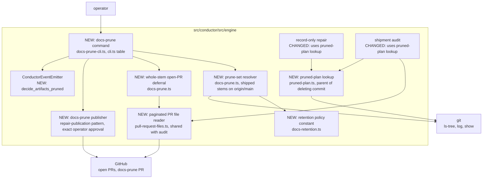
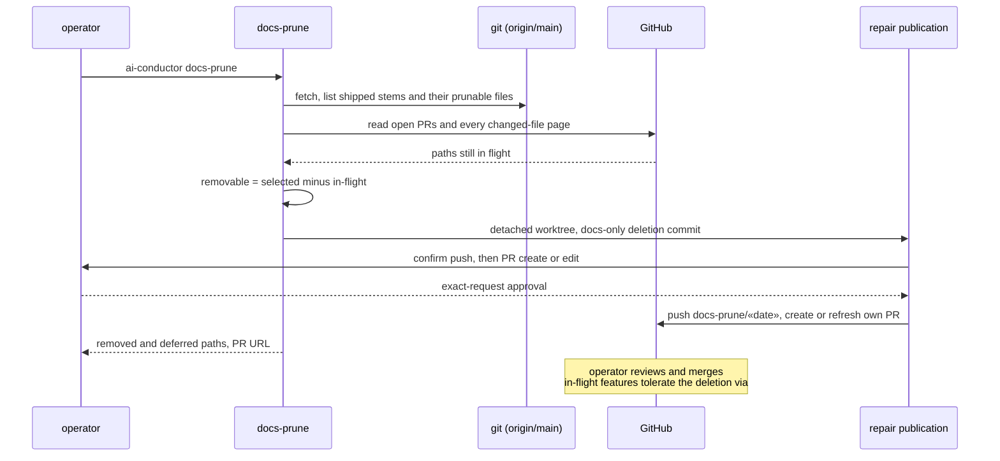

# Architecture: operator CLI prunes shipped features' DECIDE artifacts (#2963)

**Stem:** `shipped-features-decide-artifacts-accumulate-in-do`
**Tier:** M — lightweight architecture pass
**Last updated:** 2026-10-21
**Scope:** a new `ai-conductor docs-prune` command, the retention policy, and the pruned-plan lookup
used by record repair and the shipment audit.
**Governing ADR:** `adr-2026-10-15-operator-cli-prunes-shipped-decide-artifacts`
**Builds on:** `.docs/architecture/base-inherited-artifact-deletion-deadlocks-both-se.md` (#1752,
which lets in-flight features survive deletions arriving from main).

## Scope

The operator runs `ai-conductor docs-prune`, which does the following:

1. Reads `origin/main`. For every stem with a `.docs/shipped/«stem».md` record, it selects that stem's
   files in the prunable families of the retention policy.
2. Reads the changed files of every open PR through the guarded tracker read, and defers any
   selected path an open PR modifies.
3. In a temporary detached worktree, commits the deletion of the remaining paths as one docs-only
   commit. It publishes that commit on one deterministic `docs-prune/«date»` branch and PR through the
   existing guarded repair-publication pattern, creating the PR or refreshing the open one.
4. Writes every removed and deferred path, with reasons, into the PR body, and emits one
   `decide_artifacts_pruned` event on the existing spine.

It never pushes `main` and never merges.

Record-only repair and the shipment audit gain one shared lookup. When a stem's plan is absent at
the commit being read, they read the plan from the parent of the commit that deleted it. If no such
commit exists, they refuse with `shipment-plan-pruned`, naming the path.

No change to the finish path, `spec_hash`, shipment evidence or the protected-artifact seal.

## Component view (C4 level 3)

## Sequence: operator cleanup run

## Legend

- **NEW** marks an added component, and **CHANGED** marks an existing one that gains behavior.
- `«stem»` and `«date»` are placeholders.

## Change Log

| Date | Change | Reason |
|------|--------|--------|
| 2026-10-15 | Initial generation | #2963 DECIDE |
