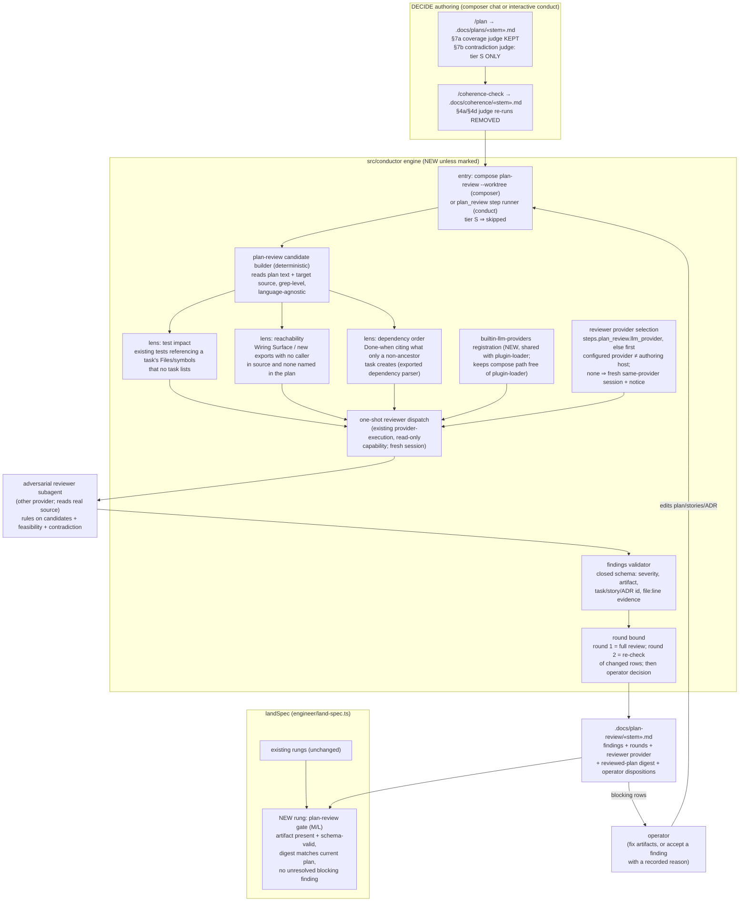
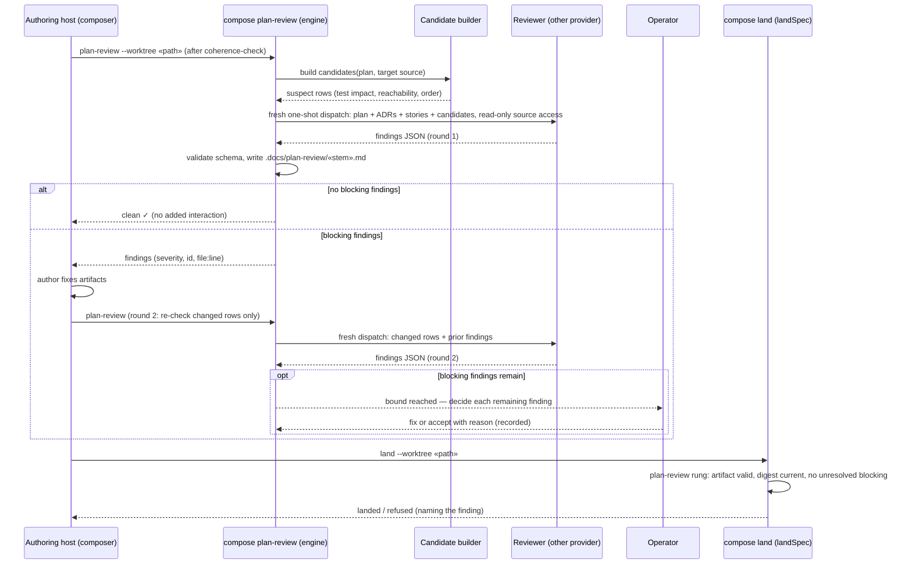

# Architecture — Source-grounded adversarial plan review before land

**Stem:** `source-grounded-plan-defects-pass-every-decide-gat` · Tier M (lightweight diagram) · 2026-10-10 · Refs #3038

**Last updated:** 2026-10-10
**Scope:** the new `plan_review` DECIDE step and its `landSpec` rung, which run at Medium/Large tier.
The step sits between `coherence_check` and land. It also covers the judge passes it replaces in
the plan and coherence-check skills.

Today every DECIDE gate reads only `.docs/` artifacts, and nothing between `/plan` and BUILD reads
the target's real source. This feature adds one review that does.

- A **deterministic candidate builder** reads the plan and the target source. It emits suspect rows
  for three defect lenses: test impact, caller reachability, and Done-when vs dependency order.
- A **fresh adversarial reviewer**, dispatched by the engine and not run in the authoring chat,
  reads the real source. It rules on those candidates and hunts for feasibility and contradiction
  defects.
- It runs on a provider other than the authoring host where one is available. Otherwise it runs in
  a fresh same-provider session, which is recorded and never blocks.
- Its findings are schema-validated into a committed artifact.
- The review is bounded to one review plus one re-check of changed rows. Then the operator decides.
- `landSpec` refuses an M/L spec with no review artifact, or with an unresolved blocking finding.

## Component / dataflow (C4 component level)

## Sequence — review, re-check, operator, land

## Legend

- **NEW unless marked:** every node in the engine subgraph is introduced by this feature. `DISP`
  reuses the existing provider-execution machinery and its read-only reviewer capability.
- **REMOVED / ONLY:** judge passes this feature retires or narrows. §7b stays for Small tier, so
  Small specs keep a contradiction check and are otherwise unaffected.
- **Bound:** at most two reviewer dispatches per spec. A third round is never dispatched; remaining
  findings go to the operator.
- **Digest:** the artifact records the plan it reviewed. A plan edited after the final review fails
  the land rung until it is re-checked, or until the operator dispositions the change within the
  bound.

## Change Log

| Date | Change | Reason |
|------|--------|--------|
| 2026-10-10 | Initial generation | #3038 DECIDE: source-grounded plan review |
| 2026-10-10 | Plan update: shared built-in provider registration; runner-owned provider fall-through with native-schema scratch | Source-grounded review of the plan (Tasks 12, 15, 24) |
