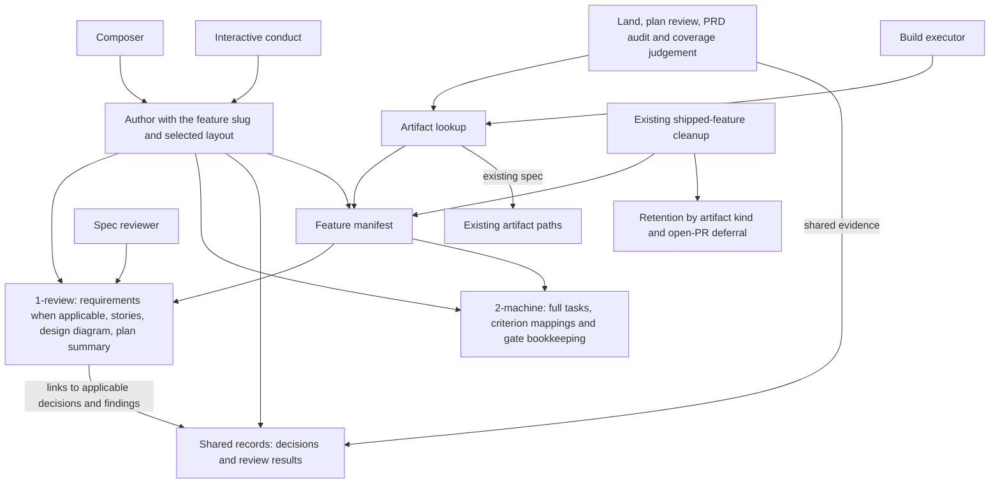

# Components for shorter spec reviews (#3419)

**Last updated:** 2026-11-19  
**Scope:** Proposed file ownership and reading paths for new specs using the review layout.

Read arrows from an author to its outputs and from a reader toward the evidence it opens. The proposed files have these responsibilities:

| Location | Reader and content |
| --- | --- |
| `1-review/01-requirements.md` | Product reviewers read goals and requirements when a PRD applies. |
| `1-review/02-stories.md` | Reviewers and validators find the authoritative wording of each acceptance criterion here. |
| `1-review/03-architecture.md` | Reviewers see the affected components and links to the governing decisions. |
| `1-review/04-plan-summary.md` | Reviewers see delivery scope, dependencies and links to relevant findings. |
| `2-machine/` | Executors read the full plan, including uniquely identifiable task completion checks. Coherence connects criterion IDs to those checks. Land reports each missing mapping. |
| Shared records | ADRs and architecture-review records stay discoverable in the decision corpus. Plan-review records keep their current location. A reviewer follows links for material decisions or findings; anything required for approval counts toward the reading-size comparison. |

Composer and interactive conduct select the layout for a new spec. Subsequent readers resolve its artifacts using the feature's recorded identity, including when the feature description differs from its plan stem. Existing manifests that point to older paths remain authoritative; specs without a manifest use their existing lookup. Plan review must be able to open referenced evidence through both its indexed and fallback paths.

## Cleanup

The operator approved the four review files and requested cleanup coverage. Cleanup uses the existing reviewed deletion PR. Retention follows artifact kind across both folders. Requirements, stories, architecture, intake and shared decisions are durable. Full tasks and coherence mappings follow existing plan and coherence retention. Retire the manifest alongside eligible records under the #3418 contract, preserve historical full-plan lookup, and defer the whole feature when an open PR touches a selected path. The plan summary follows the full plan into the same cleanup PR.

## Change log

2026-11-19 — Proposed review layout for the third spec in the #3405 series.
