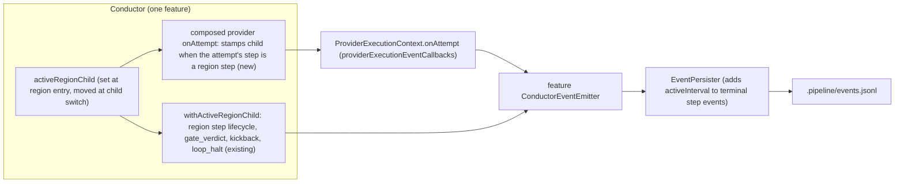
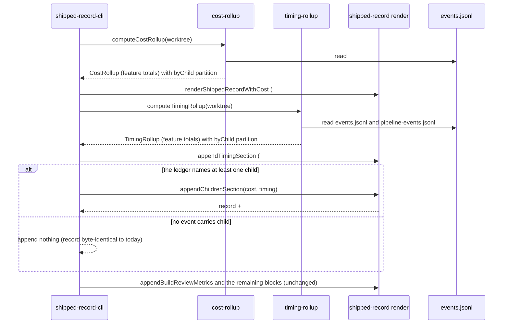

# Sequence + Components: Per-child cost and time in the shipped record

**Last updated:** 2026-10-28
**Scope:** How a stacked feature's shipped record gains cost, dispatch count and active time for each
child (#2946). The breakdown is a read-side projection of the feature's existing event ledger. Its one
emission change is that `provider_attempt` carries the existing optional `child` field.

Covered:
- stamping `child` on `provider_attempt` under the existing region rule;
- partitioning the cost rollup's dispatches by `child`;
- partitioning the timing rollup's active-interval union by `child`;
- rendering the additive `## Children` block, only when the ledger names a child.

Out of scope:
- per-child tokens, retries and halts;
- `conduct kpi` aggregation, daemon status, the dashboard and OTel dimensions;
- any change to the `## Cost` or `## Time` block.

A feature with no child never stamps the field, so its ledger, its `## Cost` and `## Time` blocks and
its whole shipped record are byte-identical to today.

## Diagram: where the child identity comes from

## Diagram: the shipped-record write

## Partition rules

- **Dispatch bucket.** Each dispatch the existing `DispatchMeteringTracker` selects is counted in the
  bucket named by its record's `child`. A record without a valid `ChildId` goes to the feature-wide
  bucket. Every selected dispatch therefore lands in exactly one bucket, and the bucket dispatch
  counts sum to `dispatches`.
- **Cost rows.** Rows are rendered from rounded prefix sums in ten-thousandths: children in ascending
  order, then feature-wide, whose prefix is the feature's own `cost_usd`. The rendered rows therefore
  sum exactly to the `## Cost` block's `cost_usd`.
- **Active time.** `C_k` is the union of the `activeInterval`s on terminal step events that carry
  child `k`. Each is a subset of the feature active union `U`. Children claim time in ascending order:
  child `k` gets `|U(C_1..C_k)| − |U(C_1..C_k-1)|`, and feature-wide gets `|U| − |U(C_1..C_n)|`. Any
  instant is counted once even if two children's intervals overlap. Rows use rounded prefixes, so they
  sum exactly to the `## Time` block's `active_ms`. Rows show time only when `## Time` shows
  `active_ms`.

## Legend

- **Region step.** One of `CHILD_REGION_STEPS` (`acceptance_specs`, `build`, `test_suite`,
  `build_review`).
- **Feature-wide.** Work outside every child's region, such as `manual_test`, `prd_audit`, the leaf
  validation group, `finish` and restack translation. By umbrella decision 12 this work stays
  unqualified even while the leaf is active.
- **Execution child.** `activeRegionChild` is set from `resolveExecutionChild` (the routed host,
  else the re-validating child, else the cursor child). A dispatch made while a routed repair or an
  operator round has re-entered a closed child's region is therefore charged to that child, which is
  where the work happened.

## Change Log

| Date | Change | Reason |
|------|--------|--------|
| 2026-10-28 | Initial diagrams | #2946 per-child cost and time |
