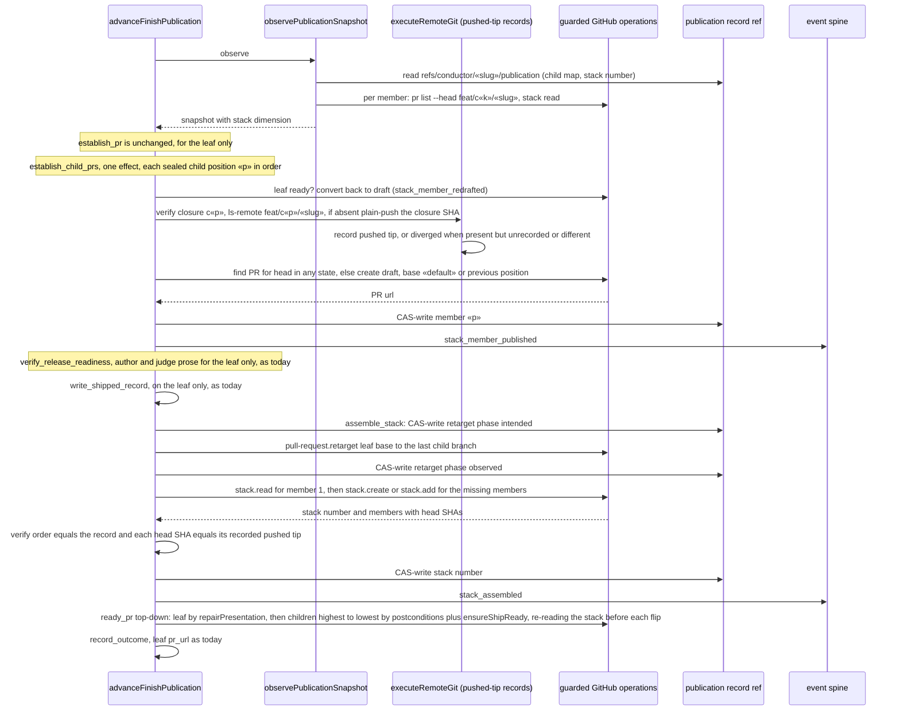
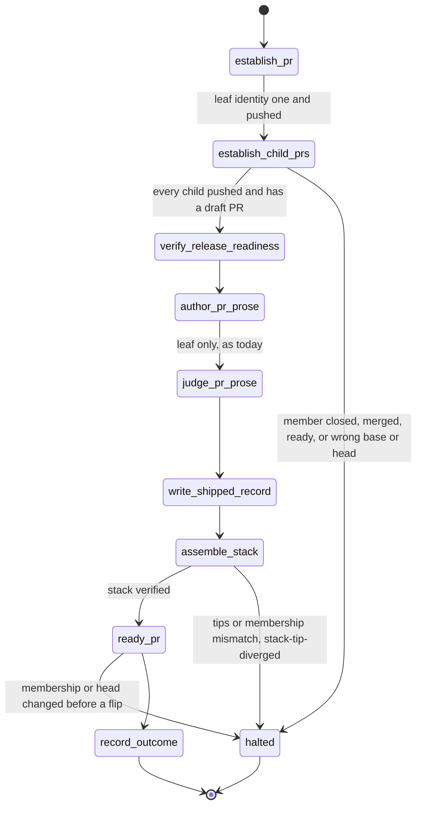
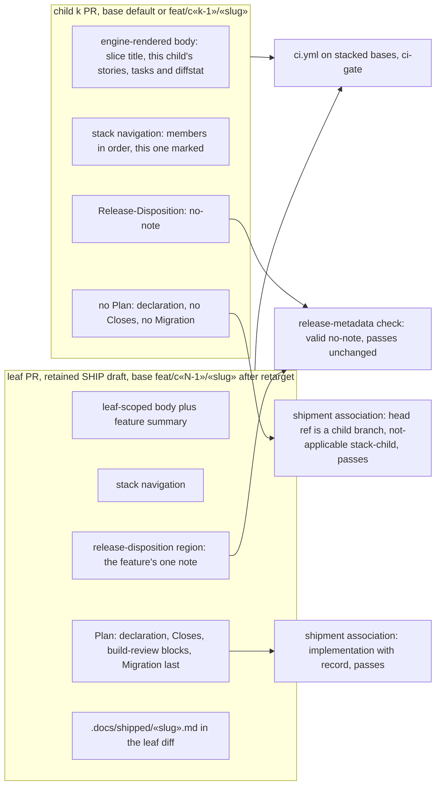
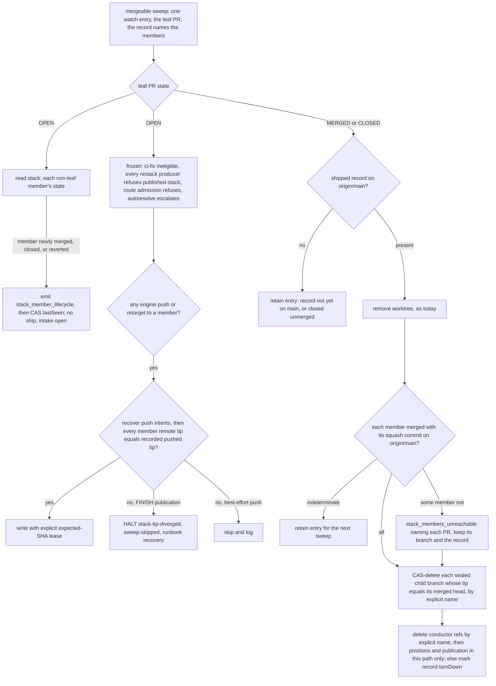

# Sequence + Components: Publish, review and ship a stacked feature as a GitHub native stack (#2945)

**Last updated:** 2026-10-17
**Scope:** The ship-path slice of #2945, the publication ticket of the stacked child-plans chain
(chain design in #2940). It covers:
- FINISH publishing a stacked feature as a native stack, one PR per child;
- the member bodies and the existing release and shipment contracts each member reuses (approach
  B);
- leaf-only ship detection and teardown after the leaf merges;
- non-leaf lifecycle events;
- the fail-closed published-stack tip guard.

Built on the shipped chain:
- #2940: branch grammar in `feature-branch-identity.ts`, per-child state, the optional event
  `child`.
- #2942: the per-child build region, closure refs and the positions ref.
- #2943: the journaled restack and `executeRemoteGit` pushed-tip records.
- #2944/#3210: routed repair, which runs before publication.

Out of scope, each filed separately: `bundled` and `Stack-Child:` contracts (#3267), `stack adopt`
and verified server-side rebase acceptance (#3268), routed-fix PR comments (#3269), and red
intermediate CI surfacing (#3270).

**Stacked** below means the sealed positions ref declares at least two positions, whatever
`stacked_prs.enabled` says now (ADR decision 1). Any other feature takes today's single-PR path
through every diagram, byte for byte; its stack observer answers `not-applicable` from local refs
before any GitHub read.

## Diagram: FINISH publication, stacked feature

The leaf draft still opens at SHIP entry (`adr-2026-07-29-ship-start-draft-pr`) with base
`«default»`. Child PRs open only during FINISH, after every leaf gate has passed.

## Diagram: publication transitions (stacked additions)

A single-PR feature's snapshot reports the stack dimension `not-applicable`. Its two stacked
transitions are never selected, so it walks today's seven transitions under today's 2 × 7
allowance. Each stacked transition processes every member in one effect, so a stacked feature's
allowance is 2 × 9 whatever its size.

## Diagram: member bodies and required checks

## Diagram: post-publication lifecycle and teardown

The ship gate is unchanged: only `.docs/shipped/«slug».md` on `origin/main` authorizes teardown, and
only the leaf diff carries that file. A merged lower prefix therefore can never ship the feature
or close its intake. A leaf merged into a child branch after a human dissolves the stack also
fails that gate.

## Diagram: components touched

```mermaid
graph TD
    subgraph Shipped["shipped by #2940 to #3210"]
        FBI[feature-branch-identity.ts: leafBranchFor, childBranchFor]
        CUR[child-cursor.ts + child-lifecycle.ts: positions, closures]
        PL[push-lease.ts + remote-git-operations.ts: pushed-tip records, expected-SHA lease]
        RRC[restack-refs-cleanup.ts: explicit-name ref teardown]
        EVT[types/events.ts: optional child]
    end
    subgraph New["new in this spec"]
        SPA[stack-publication.ts: observer, child push, members, assemble, verify, refusals]
        BODY[stack-member-body.ts: rendered child bodies and postconditions]
        PREC[stack-publication-record.ts: refs/conductor/«slug»/publication]
        TIP[stack-tip-guard.ts: called from executeRemoteGit]
        TDN[stack-teardown.ts: child deletion under the stack-member proof]
    end
    subgraph Amended["amended in this spec"]
        FPUB[finish-publication.ts: stack dimension, two transitions]
        FPP[finish-publication-production.ts: child effects, retained-draft lookup re-keyed]
        SDP[ship-draft-pr.ts: non-HEAD child push, child placeholder body]
        GHO[github-operations.ts + tracker-client.ts + mutation-policy.ts: stack.read, stack.create, stack.add, pull-request.retarget]
        CON[conductor.ts: retained-draft and release-gate lookup by recorded base]
        MS[mergeable-sweep.ts: member lifecycle, reachability, child teardown, ci-fix freeze]
        SHP[shipment-association + evidence CLI + audit + reconcile: head-ref stack-child guard]
        RST[restack call sites + daemon-rekick: published-stack refusal]
        LKP[retained-draft, release-metadata, region and halt-clearing lookups: two journaled bases]
        HM[halt-marker.ts + daemon-rekick.ts: stack-tip-diverged class]
        EV2[types/events.ts: stack publication and member lifecycle events]
        CIY[.github/workflows/ci.yml: stacked-base trigger]
        RB[docs/runbooks/stalled-or-stuck-feature.md: tip-diverged recovery]
    end
    FPUB --> SPA
    FPP --> SPA
    SPA --> BODY
    SPA --> GHO
    SPA --> PREC
    SPA --> SDP
    SDP --> PL
    SPA --> FBI
    SPA --> CUR
    MS --> PREC
    MS --> TDN
    TDN --> PREC
    MS --> TIP
    TIP --> PL
    TIP --> HM
    MS --> RRC
    SPA --> EV2
    MS --> EV2
    EV2 --> EVT
    CON --> PREC
    LKP --> PREC
    RST --> PREC
    SHP --> FBI
```

## Legend

- **Leaf.** The leaf is `feat/daemon-«slug»`, the retained SHIP draft and the feature's `pr_url`.
  **Child k** is `feat/c«k»/«slug»` for k = 1..N-1.
- **Publication record.** A compare-and-swap ref blob holding the child-to-PR map and the stack
  number. It survives worktree recreation (#497) and is deleted by explicit name at teardown.
  GitHub stays the source of truth on resume: every member is found or created by head ref.
- **Recorded pushed tip.** `refs/conductor/«slug»/pushed/«branch»`, written by `executeRemoteGit`
  (`adr-2026-10-10-stacked-restack-journaled-replay` D11).
- **Freeze and tip guard.** Once any member is published, engine rewrites of the stack are refused.
  The guard runs inside `executeRemoteGit`, and on retarget, after push-intent recovery, and never
  on a read. A partial merge the operator follows with the rest of the stack therefore never
  halts.
- **Positions.** Child positions are sealed and need not be contiguous; each child's base is the
  previous sealed position, and the last position is the leaf.
- **Events.** New members of the existing `ConductorEvent` union, carrying `child` where a member
  is named. No new channel.

## Change Log

| Date | Change | Reason |
|------|--------|--------|
| 2026-10-17 | Initial generation | #2945 DECIDE |
| 2026-10-17 | Rendered child bodies, top-down ready, freeze, journaled retarget, positions, teardown order | Architecture review (Codex and Claude adversarial rounds) |
| 2026-10-17 | Plain closure-SHA child push, all restack producers frozen, worktree removed before reachability, tornDown record | Conflict check |
| 2026-10-17 | Components named after the plan's modules (body renderer, record store, tip guard, teardown); no separate stacks adapter | Plan update |
