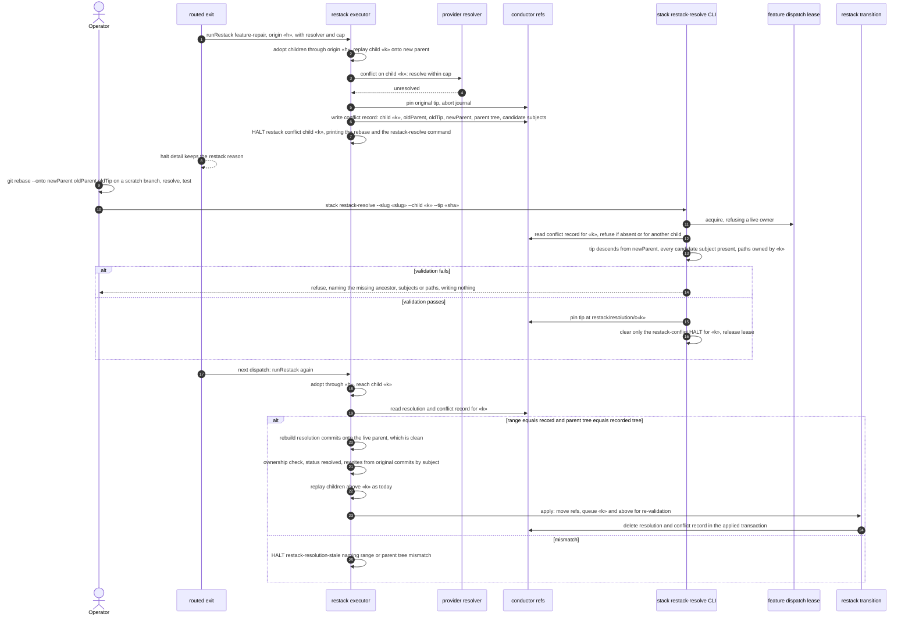
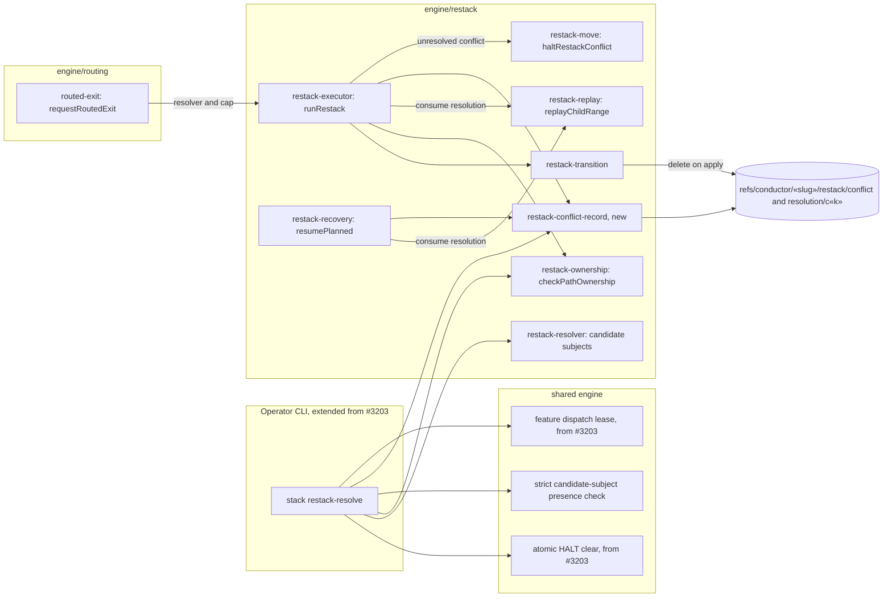

# Sequence + Components: Accept an operator-recorded resolution for a stacked restack conflict above the repaired child (#3421)

**Last updated:** 2026-10-25
**Scope:** the conflict hand-off of `adr-2026-10-10-stacked-restack-journaled-replay` (decision 6)
when a `feature-repair` restack cannot replay a child above the repaired child. This spec adds:
- **A conflict record.** Every unresolved-conflict halt also writes a durable conflict record that
  survives the journal's cleanup. It holds the conflicted child, the child's journaled range
  (`oldParent`, `oldTip`), the parent the replay was building on (`newParent`), that parent's
  tree, and the ordered replay-candidate subjects. The halt text prints the exact rebase that
  produces a valid resolution, and the `stack restack-resolve` command that records it.
- **`ai-conductor stack restack-resolve --slug «slug» --child «k» --tip «sha»`.** It joins #3203's
  operator command family and runs under its feature dispatch lease. It validates the operator's
  tip against the conflict record. If the tip passes, it pins the tip at
  `refs/conductor/«slug»/restack/resolution/c«k»` and clears only the restack-conflict HALT it
  resolves.
- **Consuming the resolution.** At the next dispatch, before replaying child `«k»`'s range, the
  restack executor (and journal recovery's `resumePlanned`) checks for a pinned resolution. When
  the range matches the conflict record and the parent being built has the recorded parent's
  tree, it rebuilds the resolution onto that parent. This replay is mechanically clean because the
  base trees are identical. The result gets the shipped ownership check and is recorded with
  status `resolved`, exactly like a provider resolver's output. Any mismatch halts and names the
  mismatch.
- **Adjacent fixes in `routing/routed-exit.ts`.** The exit restack passes the provider resolver and
  its attempt cap. Its halt keeps the restack's own reason instead of the bare word `halted`.

No engine path moves a child branch to adopt an operator's work, and `planRestackRanges` is
unchanged. Tree equality, not commit identity, is required because replayed lower children are
re-stamped with the journal's committer date (`committerStamp` in `restack-executor.ts`), so the
same parent gets a different commit id on every run.

**Built on shipped code:**
- **Executor and recovery:** `runRestack`, `resumePlanned`, `haltUnresolvedConflict`,
  `haltRestackConflict`, `pinStagingRef`, `updateRestackChildStatus`, `cleanJournal`.
- **Replay and validation:** `replayChildRange`, `checkPathOwnership`, the replay-candidate
  selection in `restack-resolver.ts`, and a strict FR-9 subject-presence check over
  `newParent..tip`, with no supersession excuse.
- **Transition:** `applyRestackTransition` and `translateAfterRebase` with the child's rewrite map.
  The transition queues the resolved child and the children above it for re-validation, and the
  leaf gates re-run at `returnToLeaf`.
- **From #3203 (prerequisite):** the `stack` CLI family, the feature dispatch lease, and the
  atomic HALT clear used by rewind.

## Diagram: conflict, operator resolution, and consumption

## Diagram: components touched

## Legend

- **Conflict record:** durable state written at the conflict halt, kept outside `restack/staging/`
  so that `cleanJournal` does not delete it.
- **Resolution ref:** the operator's validated tip. It is written only by `stack restack-resolve`
  and deleted in the transaction that applies the restack.
- **Consumed:** used as child `«k»`'s resolver output instead of a replay of its range. Children
  above `«k»` still replay normally.
- «h» is the highest originating (repaired) child and «k» a child above it.

## Change Log

| Date | Change | Reason |
|------|--------|--------|
| 2026-10-25 | Initial generation | #3421 DECIDE, approach B |
