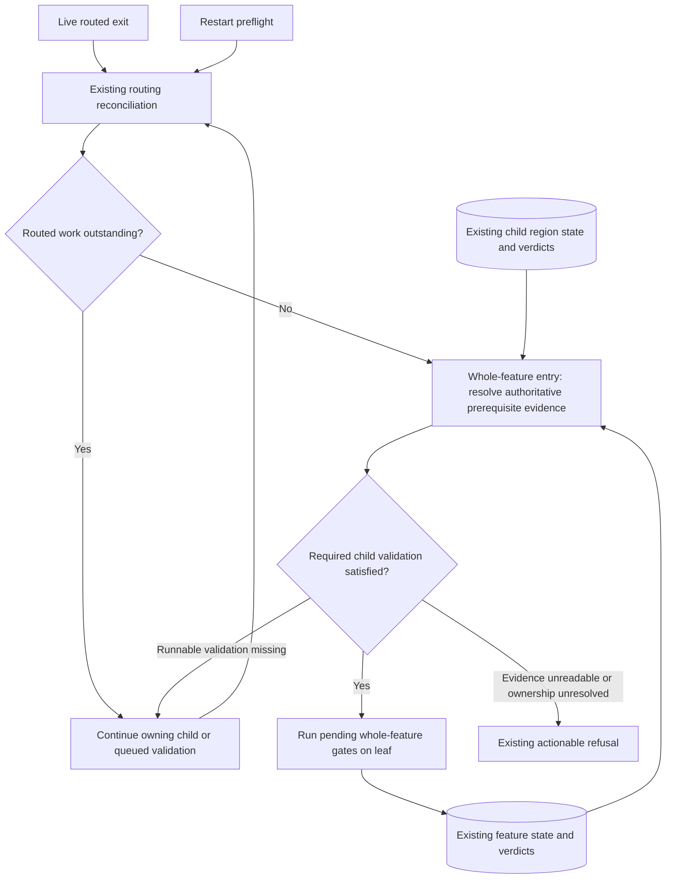

# Components: Child validation at whole-feature entry

**Last updated:** 2026-11-19
**Scope:** #3682, live routed leaf return and restart entry into whole-feature validation. This diagram expresses approved approach A for engineer validation; the subsequent lightweight architecture review will fix the exact integration seams.

## Diagram

## Authority and boundaries

- Child-region steps (`acceptance_specs`, `build`, `test_suite`, `build_review`) retain their child-owned stores. Whole-feature validation retains feature-owned state and verdicts.
- Live return and restart must agree on prerequisite satisfaction. Missing root child-region fields are not evidence that completed child BUILD work must run again.
- A closed route or a passing previous host is not, by itself, proof that all currently required validation is satisfied. Outstanding routes and revalidation queues keep precedence. Invalidated or missing child validation remains blocking.
- Resolve genuinely runnable validation to its owning child and gate. Do not manufacture root completion statuses, copy stale verdicts, bypass prerequisite checks, or introduce a mandatory duplicate suite.
- Existing evidence validity rules remain authoritative; this change adds no blanket requirement to revalidate unaffected children in every round.
- No new persisted format, configuration flag, provider seam, external call, or observation channel is proposed. Non-stacked execution preserves its existing behavior.

## Verified current-state gap

`conductor.ts::restoreWholeFeatureState` clears the child context and reloads root state. Both live routed exit and a settled-return resume can use that state. `manual_test` depends on `test_suite`, while `conduct-state-store.ts` routes that region field to the selected child. The existing root-only gate check can therefore observe a missing status instead of child completion.

The existing routed-leaf-return test fixture seeds root `test_suite` as done. Coverage for this feature must start with absent root region fields and real child-owned evidence, and include the negative case where required child validation has not passed.

## Governing architecture

- [Stacked child identity and state](../decisions/adr-2026-10-03-stacked-child-plans-identity-and-state.md): child state remains separate from feature state.
- [Per-child build region](../decisions/adr-2026-10-07-per-child-build-region.md): child execution and validation ownership.
- [Routed whole-feature repair](../decisions/adr-2026-10-12-routed-whole-feature-repair.md): outstanding hosts and revalidation precede leaf gates.

## Legend

Rectangles are existing engine responsibilities or the corrected entry behavior within the engine. Cylinders are existing durable stores. Diamonds are decisions. The evidence-resolution rectangle describes a responsibility, not a required new module or stored aggregate.
