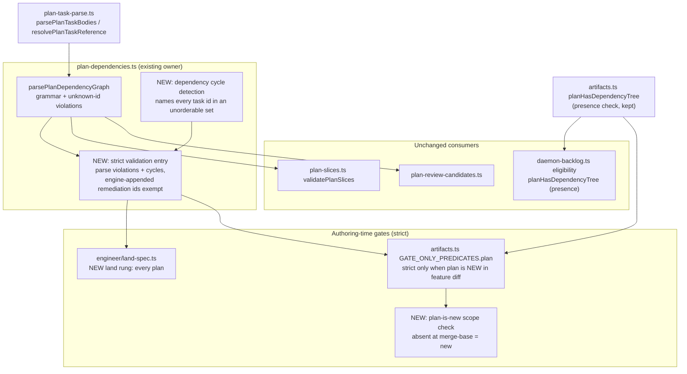
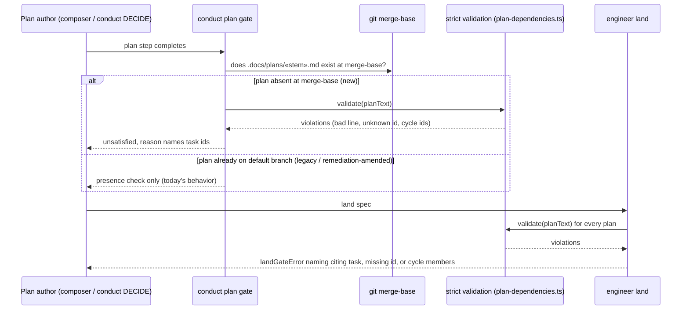

# Components: Strict plan dependency validation for new plans (#1393)

**Last updated:** 2026-11-05
**Scope:** Where the plan `**Dependencies:**` graph is validated: the shared parser, the engineer
`land` gate, the conduct `plan` gate, and daemon backlog eligibility, which stays unchanged.

## Diagram

## Legend

- **NEW** nodes are introduced by this spec; all others exist today.
- "Engine-appended remediation ids" are the ids `isEngineAppendedRemediationTaskId` recognizes; they
  are appended after land and exempt from authoring-time validation, as in `plan-slices.ts`.
- Daemon backlog eligibility and plans already on the default branch keep the presence-only
  `planHasDependencyTree` check, so no merged spec is stranded.

## Change Log

| Date | Change | Reason |
|------|--------|--------|
| 2026-11-05 | Initial generation | #1393: dependency gate was presence-only |
