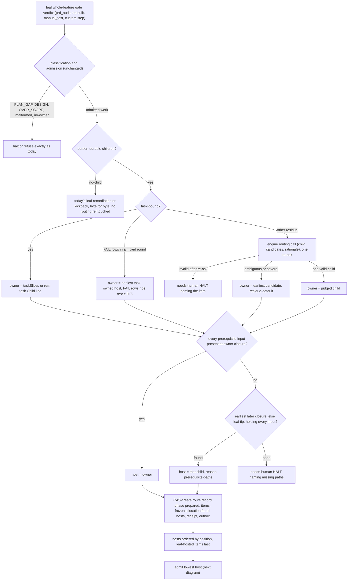
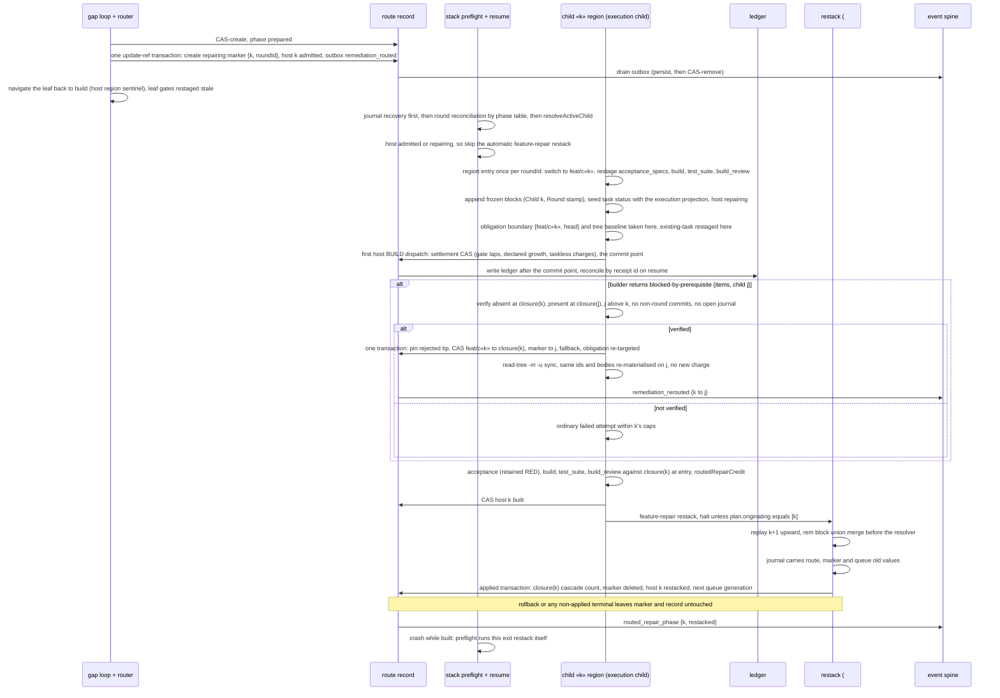
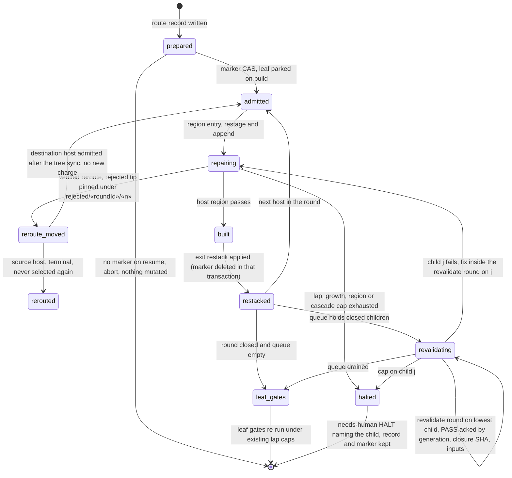
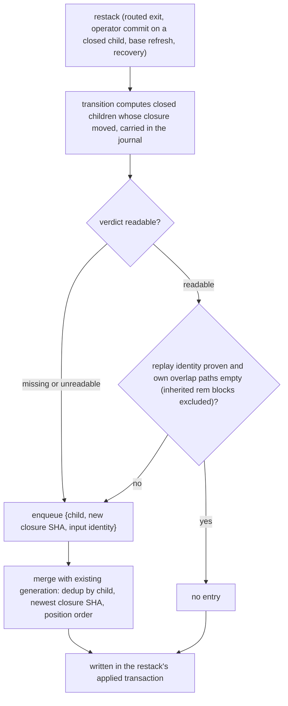
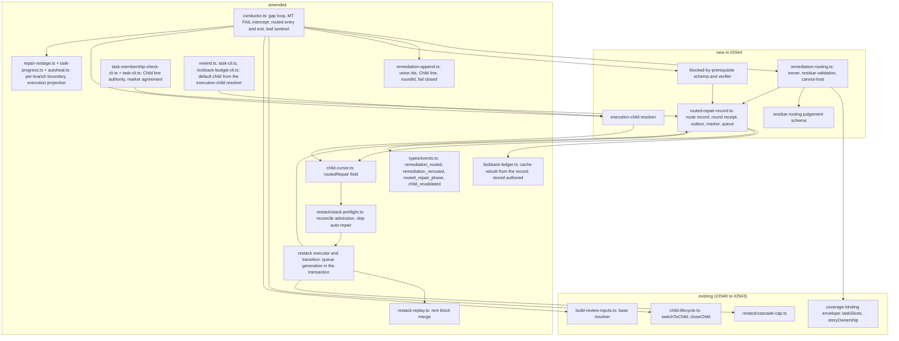

# Sequence + Components: Route whole-feature audit fixes to the owning stacked child

**Last updated:** 2026-10-12
**Scope:** How work admitted by a leaf whole-feature gate is placed in the stacked child that owns
it, built and re-validated there, and carried up the stack (#2944). It also covers re-validating
every closed child a restack moved. The manual landing aid and the closed-child rewind are #3203,
which builds on this machinery.

Covered:
- classification-first admission (unchanged), owner derivation, residue judgement and the
  cannot-host checks;
- the ref-backed route record with its round receipt and event outbox, and marker-first admission
  that survives a crash;
- the `routedRepair` cursor field and the routed-repair entry and exit transitions;
- rem-* appends on the host child's checked-out branch and their deterministic merge on replay;
- the durable re-validation queue fed by every restack transition, and its bound;

Delivery is split across four specs: #2944 (foundation, dark), #3210, #3211 and #3212 (ADR decision
18). These diagrams show the whole design.

Out of scope:
- the manual landing CLI, its shipped skill and the closed-child rewind (#3203);
- publishing a routed fix to a child PR, including the PR comment (#2945);
- per-child custom steps (#2947).

Routing is entered only when the cursor reports durable child state. When the cursor says `no-child`
(N=1, an unsliced plan, or stacking never started), every path below collapses to today's leaf-only
remediation, byte for byte. A feature that already has children keeps stacked routing and recovery
even if `stacked_prs.enabled` is later turned off, matching `child-cursor.ts` today.

## Definitions used by every diagram

The terms are defined normatively in `adr-2026-10-12-routed-whole-feature-repair`. In short:
- **Admitted work.** Task work orders (FIXABLE, REMEDIABLE, refusal rework, merged `/remediate`
  gaps) and taskless obligations (`manual_test` FAIL, post-region custom-step kickbacks).
  Classification is unchanged and runs first.
- **Owner.** Mechanical for task-bound work (`taskSlices`, or a rem task's `Child:` line). For the
  residue it comes from one engine-owned routing call: ambiguous answers take the earliest
  candidate, and invalid answers halt.
- **Host.** The child that builds the fix. It defaults to the owner and moves upward only on
  prerequisite-input evidence. The host may be the leaf, which has no closure and is processed last.
- **Execution child.** The routed host, else the re-validating child, else the cursor child. Every
  consumer reads it. The restack planner keeps the leaf as the active range.
- **Durable homes.** Every item below lives under `refs/conductor/«slug»/` and is written only
  through `update-ref --stdin` compare-and-swap.
  - `routes/«roundId»`: frozen allocation, per-host state, round receipt and event outbox.
  - `rejected/«roundId»/«n»`: pins of rejected host tips. They live in a sibling namespace because git
    cannot nest refs under the `routes/«roundId»` ref.
  - `repairing`: the marker.
  - `revalidate`: the queue, with its own outbox.

  The ledger in `.pipeline/` is written after the receipt's commit point and reconciled by receipt
  id.

## Diagram: routing a leaf gate verdict

## Diagram: admission, entry and exit of a routed repair on child «k»

## Diagram: per-host state, queue and the leaf

## Diagram: queue production by every restack

## Diagram: components touched

## Legend

- **closure(k)** is `refs/conductor/«slug»/closed/c«k»`. It moves only in a restack's journaled
  transactions (#2943). A routed repair keeps it fixed until the exit restack's `applied`
  transaction, so `resolveChildBase` for k+1 never breaks.
- **Budgets.**
  - A round charges each gate lap, its declared growth and its taskless charges once, at the first
    host's BUILD dispatch.
  - Each restack charges one cascade on its originating child.
  - Each host pass has one `routedRepairCredit` for `build_review`. It is separate from convergence
    refunds, which `feature-repair` never grants.
- **Bound.**
  - Restacks are bounded by `MAX_RESTACK_CASCADES_PER_CHILD` (3) per originating child.
  - Validation failures without a restack are bounded by each child's region caps.
  - The queue dedups by child.
  - Reroutes only move upward, so there are at most N−1 per round.

## Change Log

| Date | Change | Reason |
|------|--------|--------|
| 2026-10-12 | Initial generation | #2944 DECIDE |
