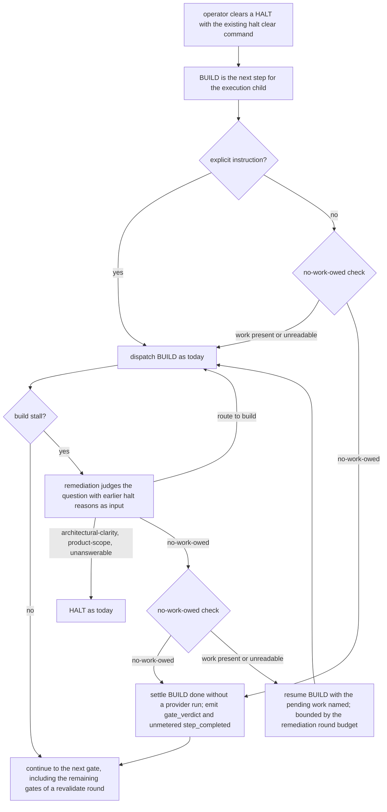

# Flow: Settling a BUILD that has no work owed (#3659)

**Last updated:** 2026-11-15
**Scope:** How the engine decides that a BUILD step has nothing to do, at two entry points: the
dispatch boundary and the build-stall remediation verdict. Both use one no-work-owed check. The
decisions are in `adr-2026-11-15-build-settles-without-dispatch-when-no-work-is-owed`.

Covered:
- the no-work-owed check and the state it reads;
- the dispatch boundary for a flat feature, a stacked child, and a routed host on a revalidate round;
- a build stall whose remediation concludes that no work is owed;
- the operator path, which uses existing commands only.

Out of scope:
- how another child's or a settled remediation input reaches a BUILD session (#3658, spec PR #3691);
- reopened-task repair resolution (#1831);
- the audit-round `derived-already-complete` exit and the kickback no-op guard, both unchanged.

## Definitions

- **No-work-owed check.** One engine function. It reports `no-work-owed` only when the existing
  BUILD completion authority says every planned task in scope is complete, and the execution child
  has no open remediation case eligible for BUILD, no hosted taskless obligation, no pending
  repair authorization, and no gate kickback pending against BUILD. Any state it cannot read counts as work present. The engine already uses
  "zero-work stall" for a `no_task_progress` stall, so this check has a different name.
- **Explicit instruction.** A run started with `--from build`, or an operator round. Both always
  dispatch.
- **Earlier halt reasons.** The most recent distinct `loop_halt` reasons on the event spine for
  this step and execution child. They are an input to the remediation judgement, not a rule.

## Diagram

## Legend

- Diamonds are engine decisions made from live state. No agent output decides them.
- "Settle BUILD done" writes the step status and its verdict through the existing step-state and
  verdict writers. The verdict records the outcome `no-work-owed` and which entry point produced it.
- Exhausting the remediation round budget halts as it does today, with the question preserved.
- There is no new operator command. When the check finds work, the existing task and
  remediation-case commands address it.

## Change Log

| Date | Change | Reason |
|------|--------|--------|
| 2026-11-15 | Initial generation | Spec for jstoup111/ai-conductor#3659 |
